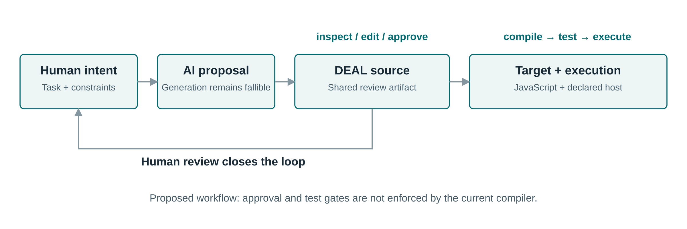
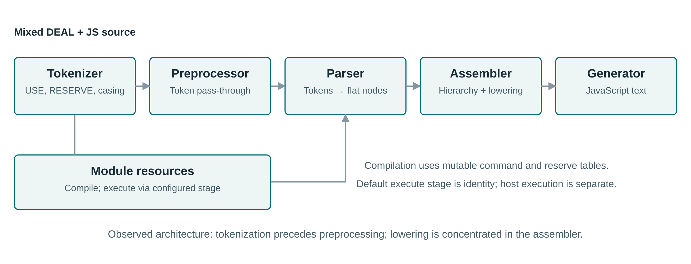
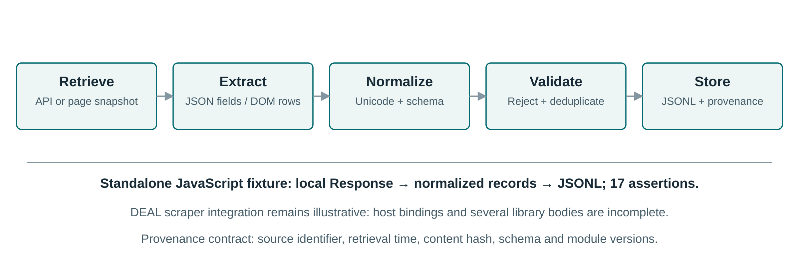
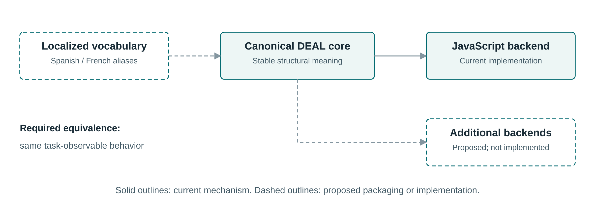

# DEAL.JS: A Constrained, Extensible Programming Layer for Inspectable Human–AI Research Workflows

Mohammad Fathi; Mehrdad CheshmeSohrabi; Ahmad Shabani; Ali Mansouri  
Department of Knowledge and Information Science, University of Isfahan, Isfahan, Iran

Working manuscript, 14 October 2026. Author names and affiliation are carried forward from the supplied draft and require author confirmation. This version presents language design, implementation inspection, a bounded stored-artifact study, and a prospective evaluation protocol; it does not report an unperformed user study, AI benchmark, or fresh compiler benchmark.

## Abstract

AI-assisted programming creates a verification problem when researchers can express a computational objective but cannot confidently inspect the resulting implementation. This paper presents DEAL, the Declarative and Extensible Abstract Language, and DEAL.JS, its JavaScript-targeting implementation, as a constrained, natural-language-like representation intended to support shared program authoring and review. The documented language combines procedural structures, reusable commands, vocabulary replacement, semantically optional words, context identifiers, and mixed JavaScript source ([DEAL.JS project](https://github.com/DEAL-X/DEAL-JS) [1]). The proposed contribution is this combination as an inspectable intermediate artifact, rather than the invention of English-like programming or an explanation of neural-network internals. A source-level inspection identifies a five-stage compiler and distinguishes implemented mechanisms from incomplete runtime libraries and proposed multilingual or additional-backend support ([DEAL.JS project](https://github.com/DEAL-X/DEAL-JS) [1]). An original inspection of three committed expected/result artifact pairs finds that all three result files parse as ECMAScript 2022 modules, while only one pair has matching normalized syntax trees; isolated probes expose a nonnumeric sorting comparator and a destructuring discrepancy. These observations characterize stored artifacts, not newly reproduced compiler behavior. A separately authored JavaScript data-processing fixture passes 17 assertions, but does not validate DEAL compilation or scraper integration. The paper develops an evaluation protocol covering translation correctness, reproducibility, human comprehension, AI generation, localization, and execution costs. DEAL.JS is consequently positioned as a research prototype whose central hypothesis, improved human oversight without reduced task correctness, remains to be tested.

Keywords: human–AI programming; controlled natural language; end-user software engineering; extensible languages; source-to-source compilation; research automation; JavaScript.

## Introduction

Code generation does not remove the need to establish that a program implements its intended task. HumanEval operationalizes code-generation assessment through functional tests, while EvalPlus demonstrates that insufficient tests can leave incorrect generated programs undetected ([Chen et al., 2021, preprint](https://arxiv.org/abs/2107.03374) [2]; [Liu et al., 2023, NeurIPS](https://proceedings.neurips.cc/paper_files/paper/2023/hash/43e9d647ccd3e4b7b5baab53f0368686-Abstract-Conference.html) [3]). For a researcher whose expertise is in a scientific domain rather than software development, a plausible-looking implementation may therefore remain difficult to audit. The relevant objective is not merely generating more code, but creating an artifact on which domain understanding, execution semantics, and testing can meet.

This objective connects to end-user software engineering, where people programming to accomplish other goals still encounter requirements, integration, testing, and debugging challenges ([Ko et al., 2011, ACM Computing Surveys](https://researchdiscovery.drexel.edu/esploro/outputs/journalArticle/The-State-of-the-Art-in/991019167334204721) [4]). A systematic mapping study further situates end-user development, end-user programming, and end-user software engineering as related fields concerned with empowering users to create and modify computational artifacts ([Barricelli et al., 2019, Journal of Systems and Software](https://expertise.unimi.it/resource/item/669695?language=en-US) [5]). DEAL investigates a language-centered response: require an executable, constrained representation that humans can review, AI can propose, and a conventional runtime can execute after translation.

The DEAL.JS README describes a natural-language-like layer that permits ordinary JavaScript in the same source, with `USE` for modules and `RESERVE` for vocabulary adaptation ([DEAL.JS documentation](https://github.com/DEAL-X/DEAL-JS) [1]). Its implementation is written in C# and organizes compilation through tokenizer, preprocessor, parser, assembler, and generator stages ([DEAL.JS implementation](https://github.com/DEAL-X/DEAL-JS) [1]). These mechanisms make the project suitable for studying inspectable program representations, but do not themselves establish usability, correctness, or reliability.

This paper makes four bounded contributions. First, it formulates a shared-artifact model of human–AI programming that separates executable transparency from model interpretability. Second, it reconstructs the prototype's language mechanisms and actual compiler architecture. Third, it presents an original, reproducible inspection of committed artifacts and a separately tested data-processing reference fixture. Fourth, it specifies experiments needed to assess whether the language delivers its intended benefits. Novelty is claimed at the level of a particular integration and research hypothesis, not universal priority over all earlier languages.

## Problem formulation and objectives

### From neural opacity to executable inspectability

Interpretability is not a single property: Lipton distinguishes transparency of a model's operation from post hoc explanations that may not faithfully expose that operation ([Lipton, 2018, Communications of the ACM](https://vis.csail.mit.edu/classes/6.859/readings/pdfs/Lipton-TheMythosOfModelInterpretability.pdf) [6]). Doshi-Velez and Kim similarly call for explicit definitions and rigorous evaluation rather than relying on unqualified interpretability claims ([Doshi-Velez and Kim, 2017, position-paper preprint](https://arxiv.org/abs/1702.08608) [7]). Accordingly, DEAL should not be described as opening the internal black box of a neural network. It instead proposes a boundary at which an AI-generated computational artifact becomes available for inspection, editing, compilation, and testing.

Three distinctions define the problem. Model transparency concerns how a neural system produces an output; program inspectability concerns whether reviewers can understand an explicit program; task correctness concerns whether that program satisfies a specification. This study targets the latter two. Even a completely visible program can be wrong, and even a correctly translated program can encode a mistaken research question.



Figure 1. Proposed shared-artifact workflow. The conceptual review loop is the paper's design proposal, not an implemented approval mechanism. The current source-to-source implementation provides a concrete program artifact; enforcement of approval, policy, and execution gates remains future work.

### Intended users and design requirements

The intended participants are researchers and domain specialists who need programmable retrieval, extraction, transformation, or storage workflows, together with professional developers supporting those workflows. The following are design requirements proposed for evaluation, not measured advantages.

- **Reviewable intent:** Domain-relevant operations should be visible without requiring the reviewer to reconstruct every low-level implementation detail.
- **Explicit translation:** Each accepted construction should have a documented target representation and defined failure behavior.
- **Incremental adoption:** Conventional target-language fragments should remain usable where a domain vocabulary is insufficient.
- **Reusable vocabulary:** Domain operations and local terminology should be shareable without arbitrary changes to the structural core.
- **Reproducible execution:** Source, module versions, compiler configuration, host capabilities, and data inputs should be identifiable.
- **Calibrated reliance:** Readers should distinguish readability from correctness and should not approve incorrect code merely because it resembles prose.

These requirements deliberately create trade-offs. A short sentence can hide a large library implementation; optional words can aid fluency while increasing lexical complexity; contextual identifiers can reduce repetition while making data dependencies less visible. The research question is whether these trade-offs improve actual review performance under controlled conditions.

## Related work and comparative positioning

### Controlled language and end-user programming

Constrained natural-language-like notation has substantial prior art: Kuhn's survey classifies controlled natural languages between unrestricted natural language and formal notation ([Kuhn, 2014, Computational Linguistics](https://aclanthology.org/J14-1005/) [8]). DEAL belongs in this design space because it restricts grammatical forms and does not attempt unrestricted prose interpretation. Its name retains “Declarative,” but its loops, assignments, and exception-handling constructs make a hybrid procedural characterization more precise for the present implementation ([DEAL.JS documentation](https://github.com/DEAL-X/DEAL-JS) [1]).

The appropriate usability question is not whether English-like words look familiar. Cognitive Dimensions offers relevant analytical concepts, including closeness of mapping, hidden dependencies, diffuseness, error-proneness, and secondary notation ([Green and Petre, 1996](https://history.futureofcoding.org/history/msg_files/F6R/F6R1A64AF.pdf) [9]). Applied here, the framework motivates questions about whether domain terms improve task mapping, whether handlers hide dependencies, and whether document-like source organization improves navigation. These are analytical hypotheses rather than substitutes for participant evidence.

### English-like scripting and extensibility

_hyperscript is a particularly close comparator: its official documentation describes HyperTalk-inspired syntax, first-class CSS selectors, asynchronous transparency, and JavaScript-defined extensions ([official _hyperscript documentation](https://hyperscript.org/) [10]). Its reference includes `repeat for x in [1, 2, 3] log x end` and explicit JavaScript embedding forms ([official _hyperscript reference](https://hyperscript.org/reference/) [11]). Therefore, readable web commands, contextual values, and JavaScript interoperation are not individually novel contributions of DEAL.

LiveCode is a further command-oriented precedent, with explicit `repeat ... end repeat` structures and iteration over text chunks or array elements ([LiveCode repeat documentation](https://docs.livecode.com/docs/LiveCode%20Script/Control%20Structures/repeat/) [12]). SugarJ provides a different architectural comparison: its sugar libraries export grammar extensions and desugarings that can be activated through imports ([Erdweg et al., 2011, OOPSLA](https://www.pl.informatik.uni-mainz.de/files/2019/04/sugarj.pdf) [13]). DEAL's current vocabulary replacement mechanism is narrower than this general form of syntactic extensibility; module inclusion and keyword aliases should not be presented as equivalent to arbitrary grammar extension ([DEAL.JS tokenizer](https://github.com/DEAL-X/DEAL-JS/blob/b85569e1e87428b73b568ffbaa92ef84dc61f1d1/DEAL.JS/Tokenizer.cs) [14]).

### Web computation and AI-generated programs

WebL predates DEAL in treating web retrieval, structured extraction, computation, and output as a programmable pipeline, introducing service combinators and a markup algebra ([Kistler and Marais, WebL paper](https://www.ra.ethz.ch/cdstore/www7/1832/com1832.htm) [15]). Source-to-source DSLs and reuse of existing host languages also have established design patterns ([Spinellis, 2001, Journal of Systems and Software](https://www.spinellis.gr/pubs/jrnl/2000-JSS-DSLPatterns/html/dslpat.html) [16]). Thus, neither web scraping nor compilation into an existing general-purpose language is sufficient as a novelty claim.

PAL uses a language model to generate intermediate programs and delegates their execution to an interpreter, establishing a relevant precedent for separating probabilistic program proposal from conventional execution ([Gao et al., 2023, ICML](https://proceedings.mlr.press/v202/gao23f.html) [17]). PICARD constrains generation through incremental parsing, and grammar-constrained decoding generalizes structural constraints to additional NLP tasks ([Scholak et al., 2021, EMNLP](https://aclanthology.org/2021.emnlp-main.779/) [18]; [Geng et al., 2023, EMNLP](https://aclanthology.org/2023.emnlp-main.674/) [19]). DEAL is currently a language/compiler prototype, not a demonstrated constrained decoder or an evaluated AI programming agent; those integration possibilities remain prospective.

### Focused comparison

Table 1 compares roles and mechanisms, not measured superiority. The DEAL column represents the inspected prototype and its documentation; other columns summarize the cited primary descriptions.

| System | Relevant mechanism | Relationship to DEAL | Boundary of the comparison |
|---|---|---|---|
| **Direct JavaScript** | DEAL's present generated language and embedded source language ([DEAL.JS](https://github.com/DEAL-X/DEAL-JS) [1]) | Essential semantic and task-performance baseline | A readable wrapper must justify its additional compiler and vocabulary burden |
| **\_hyperscript** | English-like web commands, selectors, asynchronous transparency, extensibility ([official documentation](https://hyperscript.org/) [10]) | Closest web-oriented surface comparator | DEAL emphasizes explicit target-source generation; benefits over this comparator remain untested |
| **LiveCode** | Command-oriented notation and chunk/element iteration ([official documentation](https://docs.livecode.com/docs/LiveCode%20Script/Control%20Structures/repeat/) [12]) | Human-oriented scripting precedent | Its text-chunk model is not identical to JavaScript array semantics |
| **SugarJ** | Imported grammar extensions and desugaring libraries ([OOPSLA paper](https://www.pl.informatik.uni-mainz.de/files/2019/04/sugarj.pdf) [13]) | Architectural extensibility comparator | DEAL's lexical aliases do not establish comparable grammar-extension power |
| **WebL** | Service combinators and markup algebra ([original paper](https://www.ra.ethz.ch/cdstore/www7/1832/com1832.htm) [15]) | Prior web-computation and extraction pipeline | Scraping is an application domain, not a new computational category |
| **PAL** | Generated programs executed by an external runtime ([ICML paper](https://proceedings.mlr.press/v202/gao23f.html) [17]) | Relevant human–AI execution architecture | DEAL adds a proposed review notation; PAL is not itself a comparable new surface language |

Previous systems therefore present different emphases, not a uniform deficiency that DEAL has already solved. The defensible proposed contribution is a configurable review representation combining domain commands, mixed JavaScript, document-like notation, vocabulary adaptation, and inspectable compilation, to be assessed against these precedents.

## Language model and syntax

### Four organizing concepts

The README organizes DEAL around structures, commands, reserves, and handlers, while permitting Markdown-like line markers and selected emphasis syntax ([DEAL.JS README](https://github.com/DEAL-X/DEAL-JS) [1]). Table 2 summarizes the documented forms; it is a descriptive guide rather than a complete normative grammar.

| Concept | Representative syntax | Meaning or important qualification |
|---|---|---|
| **Condition** | `IF condition, procedure; ELSE procedure;` | Procedural branching |
| **Iteration** | `FOR EACH item OF items, procedure;` | Collection-value iteration; `IN` denotes a different target operation |
| **Loop** | `WHILE condition, procedure;` | Condition-controlled repetition |
| **Block** | `BEGIN ... END;` or `DO ... END;` | Grouped procedures |
| **Callable block** | `DOING ... END;` | Arrow-function-like callable |
| **Exception handling** | `TRY ... CATCH err, ... FINALLY ...;` | Target-language exception structures |
| **Promise suffixes** | `THEN`, `OTHERWISE`, `ANYWAY` | Lower to promise continuation methods |
| **Function command** | `COMMAND name(x = value) { ... }` | Registered callable operation |
| **Definition command** | `COMMAND settings = { ... };` | Registered object or value |
| **Action command** | `# task BEGIN ... END;` | Assigned callable invoked immediately |
| **Delegation** | `const #name = value;` | Registers a case-adapted identifier |
| **Replacement reserve** | `RESERVE into AS ",";` | Lexical replacement |
| **Noise reserve** | `RESERVE the;` | Ignored readability word |
| **Module inclusion** | `USE deal/core;` | Lexically initiated resource inclusion |
| **Collection suffixes** | `WHERE`, `ORDER BY`, `LIMIT` | Intended filter/sort/slice abstractions; current contracts need correction |
| **Context handlers** | `DOCUMENT`, `RESPONSE`, `ITS` | Documented context-sensitive identifiers; runtime availability must be established |

All forms in Table 2 are documented by the project, but documentation does not establish that every combination is executable in every host ([DEAL.JS README](https://github.com/DEAL-X/DEAL-JS) [1]). In particular, the scraper tutorial explicitly states that it is illustrative and will not work as written ([project tutorial and samples](https://github.com/DEAL-X/DEAL-JS) [1]). The core language, host bindings, and application libraries must consequently be evaluated as separate components.

### Commands, names, and document-like source

The compiler maintains separate case-insensitive action, function, and definition-command dictionaries, while delegation/casing mechanisms are handled through tokenizer acceptance tables ([DEAL.JS source](https://github.com/DEAL-X/DEAL-JS) [1]). The README distinguishes case-adapted language vocabulary from ordinary user identifiers and property names after a dot ([DEAL.JS README](https://github.com/DEAL-X/DEAL-JS) [1]). This distinction should be specified through explicit name-resolution rules rather than a general claim that JavaScript becomes case-insensitive.

Action definitions deserve particular attention: the documented translation has the form `(task = (() => { ... }))();`, combining definition and immediate execution ([DEAL.JS README](https://github.com/DEAL-X/DEAL-JS) [1]). Although the heading-like notation resembles documentation, it is executable and can create effects. The reviewer must know that a heading is not merely a section label, and a future editor should expose that distinction.

The tokenizer removes selected list-style prefixes before tokenization and recognizes selected emphasis/delegation forms ([DEAL.JS tokenizer](https://github.com/DEAL-X/DEAL-JS/blob/b85569e1e87428b73b568ffbaa92ef84dc61f1d1/DEAL.JS/Tokenizer.cs) [14]). These are Markdown-like conventions, not evidence that arbitrary Markdown is a valid program. Because preprocessing occurs at the source-string level for the list-marker replacement, regression tests should include similar patterns inside template literals and comments.

### Matched technical examples

Listing 1 is an author-constructed DEAL example based on documented loop syntax, not a fresh compiler-tested fixture. Its target listing is the intended JavaScript counterpart, supported by the assembler's loop construction, not a captured compilation result ([DEAL.JS assembler](https://github.com/DEAL-X/DEAL-JS/blob/b85569e1e87428b73b568ffbaa92ef84dc61f1d1/DEAL.JS/Assembler.cs) [20]).

```text
USE deal/core;
const values = [1, 2, 3];
FOR EACH value OF values, BEGIN
    console.log(value);
END;
```

```javascript
const values = [1, 2, 3];
for (const value of values) {
    console.log(value);
}
```

Listing 2 expresses collection iteration in _hyperscript using its documented form; it is a surface comparison rather than a benchmark result ([official reference](https://hyperscript.org/reference/) [11]). Listing 3 uses LiveCode text items, which differ in representation from a JavaScript array ([LiveCode documentation](https://docs.livecode.com/docs/LiveCode%20Script/Control%20Structures/repeat/) [12]).

```text
repeat for value in [1, 2, 3]
    log value
end
```

```text
put "Alice,Bob,Carol" into names
repeat for each item person in names
    put person
end repeat
```

Listing 4 illustrates the architectural difference from SugarJ: an imported sugar library can introduce pair syntax that desugars into ordinary Java types and constructor calls ([Erdweg et al., 2011](https://www.pl.informatik.uni-mainz.de/files/2019/04/sugarj.pdf) [13]). No equivalent arbitrary grammar-extension capability is claimed for the current DEAL `RESERVE` mechanism.

```java
import pair.Sugar;
private (String, Integer) p = ("12", 34);
```

### Vocabulary adaptation and multilingual prospects

The inspected tokenizer implements noise words and replacement reserves during tokenization, with some structural words treated specially before reserve application ([DEAL.JS tokenizer](https://github.com/DEAL-X/DEAL-JS/blob/b85569e1e87428b73b568ffbaa92ef84dc61f1d1/DEAL.JS/Tokenizer.cs) [14]). The README includes a Spanish-style example, but an example is not a validated locale package or evidence of cross-linguistic equivalence ([DEAL.JS README](https://github.com/DEAL-X/DEAL-JS) [1]). A modest prospective locale layer could use the following single-word aliases; these are proposed module contents, not shipped modules:

```text
// Proposed Spanish vocabulary fragment
RESERVE cada;
RESERVE para AS "for";
RESERVE de AS "of";
// Example: para cada value de values, console.log(value);
```

```text
// Proposed French vocabulary fragment
RESERVE chaque;
RESERVE pour AS "for";
RESERVE de AS "of";
// Example: pour chaque value de values, console.log(value);
```

These fragments demonstrate lexical adaptation only. A complete multilingual design must address collisions, accented identifiers, morphology, multiword phrases, string protection, locale-independent case folding, and diagnostics in the user's language. Native-speaker review and equivalence tests are necessary before claiming that a localized notation reduces barriers.

## Compiler architecture and execution boundary

### Observed stage order

The DEAL.JS engine extends a JavaScript engine and configures the order `Tokenizer → Preprocessor → Parser → Assembler → Generator` ([DEAL.JS implementation](https://github.com/DEAL-X/DEAL-JS) [1]). The generic engine applies each configured stage's `Transform` method to the previous stage's output ([generic engine implementation](https://github.com/DEAL-X/Engine/blob/32431a3ae47367837f195b43767b408cf1788530/Engine/Engine.cs) [21]). Figure 2 depicts this inspected architecture, including the nontrivial dependency side path.



Figure 2. Source-derived compiler architecture. Contrary to a conventional preprocess-first diagram, the configured tokenizer precedes the token preprocessor; DEAL-specific `USE` and `RESERVE` handling occurs in tokenization ([tokenizer implementation](https://github.com/DEAL-X/DEAL-JS/blob/b85569e1e87428b73b568ffbaa92ef84dc61f1d1/DEAL.JS/Tokenizer.cs) [14]). No optimizer, verified intermediate representation, or complete source-map subsystem is inferred from this pipeline.

The tokenizer extends JavaScript tokenization with command acceptance, vocabulary rewriting, path handling, and document-like surface forms ([tokenizer implementation](https://github.com/DEAL-X/DEAL-JS/blob/b85569e1e87428b73b568ffbaa92ef84dc61f1d1/DEAL.JS/Tokenizer.cs) [14]). The DEAL preprocessor adds no transformation beyond its base implementation, and the parser mainly classifies independent nodes before the assembler constructs hierarchy and performs lowering ([DEAL.JS implementation](https://github.com/DEAL-X/DEAL-JS) [1]; [generic engine](https://github.com/DEAL-X/Engine) [22]). The DEAL generator inherits JavaScript generation behavior rather than implementing an independent target backend ([DEAL.JS implementation](https://github.com/DEAL-X/DEAL-JS) [1]). These details matter because the principal semantic transformations are concentrated in assembly, not in a separate formal semantic-analysis stage.

### Module inclusion and runtime integration

The tokenizer resolves module paths and tries `.deal`, `.djs`, and `.js` extensions, with folder traversal as another inclusion route; its URL-loading method currently returns zero ([tokenizer implementation](https://github.com/DEAL-X/DEAL-JS/blob/b85569e1e87428b73b568ffbaa92ef84dc61f1d1/DEAL.JS/Tokenizer.cs) [14]). The generic `UseDependency` path compiles and executes a dependency through the configured execution stage, then records its path and raises an event ([generic engine implementation](https://github.com/DEAL-X/Engine/blob/32431a3ae47367837f195b43767b408cf1788530/Engine/Engine.cs) [21]). Thus, `USE` should not be described simply as JavaScript's standard module import or as guaranteed self-contained bundling.

The generic engine's default execution stage returns its input unchanged, whereas the separate Environment project configures ClearScript V8 evaluation and exposes host objects ([generic engine implementation](https://github.com/DEAL-X/Engine/blob/32431a3ae47367837f195b43767b408cf1788530/Engine/Engine.cs) [21]; [Environment project](https://github.com/DEAL-X/Environment) [23]). The inspected Environment project targets .NET 5 and a Windows x86 native V8 package, while the language project targets .NET Standard 2.0 ([Environment project](https://github.com/DEAL-X/Environment) [23]; [DEAL.JS project](https://github.com/DEAL-X/DEAL-JS) [1]). Emitting JavaScript therefore does not establish that every program is portable across Node.js, browsers, and this host without adapters.

### A proposed reproducibility contract

For scientific use, define compilation as a function of more than source text:

\[
C(s,m,o,h,\sigma_0)=j,
\]

where \(s\) is source, \(m\) is an ordered, versioned module set, \(o\) is compiler configuration, \(h\) is host/resource configuration, and \(\sigma_0\) is initial compiler state. This is a proposed analytical contract, not a proof of the current implementation. Deterministic translation requires identical \(j\) for identical inputs to this full function; reproducible behavior additionally requires controlled data, runtime, external responses, and scheduling.

Likewise, semantic preservation should be evaluated on a specified supported subset:

\[
\operatorname{Obs}(\operatorname{Exec}(C(s,m,o,h,\sigma_0),e))
=
\operatorname{Spec}(s,e).
\]

Here, \(\operatorname{Obs}\) denotes task-relevant outputs, errors, persistent changes, and event order under controlled environment \(e\). A reference specification or independently authored implementation must define the right-hand side; the compiler's own output cannot be its sole correctness oracle. These equations separate determinism, translation correctness, and environmental reproducibility instead of treating them as synonyms.

## Research application: retrieval, extraction, processing, and storage

### The scraper-oriented use case

The tutorial describes an API-first workflow with browser fallback, field extraction, text normalization, numerical transformation, and append-based storage using `scraper` and resource-related commands ([project tutorial](https://github.com/DEAL-X/DEAL-JS) [1]). This is a useful motivating application, but the same tutorial warns that it is non-executable, and the inspected library includes incomplete selector, transfer, context-handler, and projection bodies ([project tutorial and library](https://github.com/DEAL-X/DEAL-JS) [1]). Consequently, the paper presents the integration as an intended use case rather than a completed scraping system.

Listing 5 adapts the README's scrape-and-append idiom and is explicitly illustrative. It must not be used as a runnable result or as an evaluated extraction benchmark ([documented idiom](https://github.com/DEAL-X/DEAL-JS) [1]).

```text
USE scraper;
FOR EACH url OF sources,
    LOAD url,
    THEN APPEND ALL "h3.title", TO destination;
```

An implementation suitable for reproducible research should separate retrieval, extraction, normalization, validation, and storage. This separation allows field-level failures to be inspected and avoids hiding scientific decisions inside a single attractive command. Figure 3 presents the proposed processing contract and the scope of the independent reference fixture.



Figure 3. Proposed application pipeline. The standalone fixture exercises local JSON retrieval semantics, normalization, validation, deduplication, and JSONL serialization; it neither runs a live scraper nor compiles DEAL. Snapshot provenance is a proposed research requirement.

### A runnable reference slice

The supplementary JavaScript fixture constructs a local `Response`, awaits `response.json()`, and processes five synthetic records. No live service, user data, or commercial price observation is involved. Its normalization rules retain zero values, reject missing or invalid numeric values, normalize Unicode and whitespace, and keep the first valid record for each identifier.

```javascript
function normalize(row) {
    if (!row || row.id == null ||
        typeof row.title !== "string") return null;
    const id = String(row.id).trim();
    const title = row.title.normalize("NFKC")
        .replace(/\s+/gu, " ").trim();
    if (!id || !title || row.price == null ||
        String(row.price).trim() === "") return null;
    const price = Number(row.price);
    if (!Number.isFinite(price) || price < 0) return null;
    return { id, title, price };
}
```

This listing is authored reference JavaScript, not generated target code. Its full supplementary script records accepted and rejected rows, checks JSONL round-trip behavior, and writes only local fixture outputs. In a future DEAL experiment, a DEAL program and an independently authored JavaScript baseline should implement this same contract against identical inputs.

For a browser extraction adapter, the minimum contract is a document or snapshot plus selectors, returning plain records rather than live DOM objects. A representative JavaScript adapter could map `document.querySelectorAll("table tbody tr")` into field strings before invoking normalization; it is not part of the executed fixture. An eventual storage adapter should preserve source identifiers, retrieval times, content hashes, schema versions, and compiler/module versions, and should use explicit encodings and well-defined CSV or JSONL serialization.

### Asynchrony and failure semantics

The inspected assembler maps `THEN`, `OTHERWISE`, and `ANYWAY` to `.then`, `.catch`, and `.finally`, and some generated wrappers call `handle(data)` ([DEAL.JS assembler](https://github.com/DEAL-X/DEAL-JS/blob/b85569e1e87428b73b568ffbaa92ef84dc61f1d1/DEAL.JS/Assembler.cs) [20]). These are promise continuations, not evidence of multithreaded execution. A sequential-looking source must therefore be tested for actual completion order, rejected promises, nested JSON parsing, and context isolation.

The stored scraper-oriented output launches promise work from a loop without an explicit aggregate completion barrier, while the tutorial uses `response.json()` as if it were already an iterable result ([project samples](https://github.com/DEAL-X/DEAL-JS) [1]). These observations motivate explicit `await`, returned promises, or an aggregate await in a corrected implementation. Because the current host may define its own response abstractions, the paper does not assume that every documented `RESPONSE` is the browser's standard `Response`.

## Study method and artifact scope

### Inspection protocol

The primary snapshot is DEAL-JS commit `b85569e1e87428b73b568ffbaa92ef84dc61f1d1`; the repository identifies this as its October 9, 2026 update ([public repository](https://github.com/DEAL-X/DEAL-JS) [1]). Supporting source inspection covers Engine commit `32431a3ae47367837f195b43767b408cf1788530` and Environment commit `4a38cf748b4f9040ab3b6d596d495c8883322c4f` ([Engine](https://github.com/DEAL-X/Engine) [22]; [Environment](https://github.com/DEAL-X/Environment) [23]). The organization profile README and supplied draft were also consulted, but do not constitute independent validation.

Review coverage includes the primary README, tutorial, all three source/expected/result stress families, both tutorial Markdown samples, the command example, all 12 DEAL/JavaScript stage source files, all 14 primary library files, project configuration, and relevant generic-engine and host code. Committed build-output copies and binaries were treated as distribution artifacts, not independent source evidence. The review did not modify repository files.

Two small, separately authored scripts provide original checks. The artifact-audit script compares SHA-256 hashes and normalized Acorn syntax trees for the three expected/result pairs, parses them in ECMAScript 2022 script and module modes, and executes only isolated hand-transcribed comparator/destructuring probes. Normalization removes positions and raw literal spelling but retains syntactic structure and literal values. The reference-pipeline script evaluates a local synthetic-data transformation independently of DEAL.

The environment used Node.js v20.20.2 and Acorn 8.16.0. No `dotnet` or `mono` executable was available, so the C# compiler and ClearScript host were not built or executed. In particular, no claim is made that committed outputs were regenerated from the inspected commit. This limitation is explicit rather than replaced with invented conformance measurements.

## Observed results

### Stored-artifact consistency

Table 3 reports original measurements from the audit script. “Module parseable” means syntactically accepted by the specified parser; it does not mean the artifact will execute successfully under strict module semantics, that its dependencies exist, or that its behavior is correct.

| Committed sample family | Byte-identical expected/result | Matching normalized AST | Result parses as script | Result parses as module |
|---|---:|---:|---:|---:|
| DEAL Stress Test | No | No | Yes | Yes |
| Complex Stress Test | No | Yes | No | Yes |
| JavaScript Stress Test | No | No | Yes | Yes |
| **Count** | **0/3** | **1/3** | **2/3** | **3/3** |

Byte differences alone are weak evidence because formatting and comments can change without changing behavior. The normalized comparison removes those differences and still identifies two mismatching pairs. Conversely, matching ASTs in the complex pair do not establish semantic correctness: expected and result artifacts can share a defect.

The complex result's script-mode rejection occurs at the top-level `await` expression; module mode accepts it. However, the same file contains an action assignment without an explicit declaration, which must be considered separately for strict module execution. This illustrates why parsing and executable-host compatibility require distinct checks.

### Focused behavioral probes

The inspected `ORDER` lowering constructs a comparator of the form `(a,b)=>(a,b)=>...`, which returns a function rather than a comparison number ([assembler source](https://github.com/DEAL-X/DEAL-JS/blob/b85569e1e87428b73b568ffbaa92ef84dc61f1d1/DEAL.JS/Assembler.cs) [20]). In an original isolated Node.js probe, sorting keys `[3,1,2]` with that exact comparator shape leaves `[3,1,2]`, rather than the specified ascending order `[1,2,3]`. This verifies the consequence of the comparator expression, not the output of a freshly run DEAL compiler.

The stored JavaScript expected artifact retains a destructuring hole, `const [, , third] = values`, whereas the result contains `const [third] = values` ([sample artifacts](https://github.com/DEAL-X/DEAL-JS) [1]). Executing these two declaration forms separately with `[10,20,30]` produces 30 and 10 respectively. This is a task-observable disagreement, not merely a formatting difference.

The source fixture contains `"line\nbreak"` while the stored result contains `"linenbreak"`, and the inspected tokenizer drops the escape introducer while reading strings ([source and sample artifacts](https://github.com/DEAL-X/DEAL-JS) [1]). This is consistent with an escape-preservation defect; reproduction against a fresh build remains necessary. The DEAL stress pair also differs in identifier casing, including `testE` versus `teste`, which should become a dedicated name-resolution regression case ([sample artifacts](https://github.com/DEAL-X/DEAL-JS) [1]).

These observations do not support describing the current artifact as semantically verified or fully JavaScript-compatible. They instead identify precise tests and implementation contracts needed to evaluate those claims.

### Independent data-processing fixture

The reference fixture passes all 17 authored assertions. It accepts two of five synthetic rows and rejects three, comprising one duplicate and two invalid values. Assertions cover whitespace normalization, NFKC normalization, numeric strings, preservation of zero, invalid numeric cases, missing identifiers, empty titles, null rows, record counts, duplicate labeling, and serialization round-trip.

These results validate only the small reference program under its test inputs. They do not establish web-extraction accuracy, browser operation, DEAL usability, compiler performance, or scientific validity of downstream analysis. The value of the fixture is an explicit oracle that a later DEAL implementation can be tested against.

## Prospective evaluation protocol

### Compiler correctness and reproducibility

The next study should start with a clean, version-pinned source build and a command-line runner that emits source, generated code, diagnostics, dependency manifest, and environment metadata. Repository stress cases should be split into minimal fixtures with independent expected behavior, including invalid-input tests. The following research questions and measures are proposed, not completed experiments.

| Research question | Primary measures | Necessary controls |
|---|---|---|
| **Translation correctness** | Output equivalence, error equivalence, side effects, event order | Independent JavaScript oracles; immutable inputs; explicitly supported subset |
| **Compilation determinism** | Output hashes across repeated fresh builds | Compiler state, module order, locale, OS, line endings and configuration |
| **Human review** | Correctness of comprehension and defect detection; completion time | Counterbalanced tasks; proficiency measures; equal onboarding and libraries |
| **AI generation** | End-to-end functional success; repair attempts and cost | Frozen model versions; matched tasks, budgets and documentation |
| **Localization** | Canonical-output/behavior equivalence; review accuracy | Native-speaker validation; fixed identifiers and domain logic |
| **Additional targets** | Cross-backend observable equivalence | Supported subset; host adapters; numeric and async contracts |
| **Operational performance** | Compile time, peak memory, output size, execution overhead | Warm-up protocol; matched implementations; machine/runtime metadata |

Compiler tests should cover literals and escapes, regular-expression/division boundaries, sparse destructuring, precedence, identifier case, property names, commands, scope, nested blocks, promises, and error propagation. Module tests should cover absent modules, duplicate imports, cycles, conflicting aliases, deterministic traversal, and failure diagnostics. Execution tests should use local snapshots and mocks before any changing live website.

Normalized syntax-tree comparison is useful for translation regression but cannot replace behavioral tests. EvalPlus provides independent motivation for expanding test inputs rather than relying on a small set of passing examples ([Liu et al., 2023](https://proceedings.neurips.cc/paper_files/paper/2023/hash/43e9d647ccd3e4b7b5baab53f0368686-Abstract-Conference.html) [3]). Metamorphic tests should verify that adding a declared noise word, changing permitted command casing, or applying a locale alias preserves observable behavior.

### Human-comprehension experiment

A preregistered, counterbalanced crossover design should compare DEAL, direct JavaScript, and _hyperscript on overlapping tasks. Participants should include domain researchers with limited coding experience and a separately analyzed experienced-programmer group. Sample size should be selected through a pilot-informed power or precision analysis, not an arbitrary claim that a particular participant count guarantees significance.

Tasks should include predicting outputs, identifying seeded semantic defects, making a small transformation change, and reviewing an AI-generated pipeline for approval. Primary outcomes should be review accuracy and defect detection; time and subjective workload should be secondary. The most important adverse outcome is false approval of plausible but incorrect programs.

Equivalent domain libraries must be provided to all conditions. Otherwise, a comparison may incorrectly attribute the benefit of a good extraction API to DEAL's syntax. Analysis should account for participant and task variation, prior language familiarity, learning order, English/local-language proficiency, uncertainty intervals, and prespecified multiple-comparison handling. Qualitative interviews can explain failure mechanisms but should not be substituted for correctness measurements.

### AI-generation experiment

The AI study should compare generation into DEAL and direct JavaScript using the same task specification, tools, time limits, and test oracles. A second baseline should expose the same domain-command API in ordinary JavaScript; a third, where appropriate, should use a structured schema or constrained DSL. No named model is assumed to perform better, and no model comparison was executed for this manuscript.

The primary outcome should be end-to-end functional success, counting malformed DEAL, compilation failures, unsupported commands, and runtime failures as failures rather than excluding them. Report first-attempt success, success after a fixed repair budget, total tokens, latency, and human correction effort. HumanEval provides a precedent for functional rather than superficial text-similarity assessment ([Chen et al., 2021](https://arxiv.org/abs/2107.03374) [2]). For stochastic sampling with \(n\) candidates, \(c\) passing candidates, and \(k\leq n\), an optional task-level estimator is:

\[
\widehat{\mathrm{pass@k}}
=1-\frac{\binom{n-c}{k}}{\binom{n}{k}}.
\]

The estimator should be applied only under a documented sampling protocol, not to deterministic retries or selectively retained outputs. A low-resource language can face a training-distribution disadvantage relative to JavaScript, so experiments should distinguish zero-shot familiarity from documentation-assisted generation and from any fine-tuned condition.

### Localization, portability, and ablations

Locale tests should compare English, Spanish, and French vocabulary modules over identical task logic and fixed identifier conventions. Equality of canonical output is a useful narrow criterion; behavioral equivalence remains necessary when wrappers or diagnostics differ. Separate human studies must determine whether localization aids review rather than merely changing spelling.

Portability should initially target a language-independent subset: values, conditionals, collection iteration, explicitly scoped commands, and abstract resource operations. JavaScript-specific fragments should be rejected by a non-JavaScript backend or isolated behind declared foreign-language adapters. Numeric behavior, object representation, exceptions, iteration, asynchronous execution, and storage effects need explicit mappings.



Figure 4. Proposed extension contracts. Lexical replacement and a JavaScript backend exist as mechanisms; complete localized packages and additional backends are not established by the inspected artifacts ([DEAL.JS implementation](https://github.com/DEAL-X/DEAL-JS) [1]). Backend independence requires a separately specified portable subset rather than unrestricted reuse of JavaScript-bearing source.

Ablations should isolate vocabulary commands, noise words, document-like layout, explicit versus contextual state, and localized aliases. These comparisons test which mechanism contributes value. Without them, any overall result would be difficult to interpret as a programming-language contribution.

## Discussion, limitations, and future work

The principal innovation under investigation is a shared review artifact, not a new mechanism for explaining neural weights. Conventional compilation can make an explicit computational proposal available for inspection, but it cannot guarantee that the proposal matches a researcher's intent. The artifact study reinforces this distinction: syntactically valid output and readable notation coexist with behavioral discrepancies.

The current implementation has concrete scope limits. Selector and web-transfer library bodies are incomplete; `collect` returns an arguments object rather than establishing a named-field record contract; `select` does not implement the tutorial's full projection semantics; and context handling is not a complete demonstrated runtime ([inspected library](https://github.com/DEAL-X/DEAL-JS) [1]). The compiler's sorting translation requires correction, `LIMIT` needs an unambiguous end-index versus count contract, and promise-related examples need explicit completion and error rules ([assembler implementation](https://github.com/DEAL-X/DEAL-JS/blob/b85569e1e87428b73b568ffbaa92ef84dc61f1d1/DEAL.JS/Assembler.cs) [20]). These are implementation and specification limitations, not evidence that the high-level research objective is impossible.

Module reproducibility is another limitation. Folder inclusion traverses provider results, and the generic dependency list is updated only after compiling/executing the dependency, so deterministic ordering and cyclic-import handling require targeted validation ([tokenizer](https://github.com/DEAL-X/DEAL-JS/blob/b85569e1e87428b73b568ffbaa92ef84dc61f1d1/DEAL.JS/Tokenizer.cs) [14]; [generic engine](https://github.com/DEAL-X/Engine/blob/32431a3ae47367837f195b43767b408cf1788530/Engine/Engine.cs) [21]). Configurable stages and options are architectural extension points, not proof of semantic isolation or effective optimization. A reproducible package should make these behaviors explicit.

The review has substantial validity limits. It examines a small, author-maintained fixture set rather than a representative corpus, cannot establish how the committed outputs were produced, and does not include independent compiler execution, participant data, live scraping measurements, or multilingual evaluation. Syntax-tree equivalence is not behavioral equivalence, and the reference JavaScript fixture cannot be generalized to compiler correctness. There is also a risk of confirmation bias when a language's designers choose examples and evaluation tasks.

Security is not solved by readable syntax. Embedded JavaScript, included dependencies, and exposed host objects can perform effects outside the visible high-level command; the inspected host exposes a compiler object and configures V8 execution ([Environment project](https://github.com/DEAL-X/Environment) [23]). Future work should introduce capability-scoped resource adapters, import allowlists, a side-effect manifest, isolated execution, and explicit approval for network or file operations. Such controls are proposed safeguards, not current guarantees.

The near-term roadmap should prioritize semantic contracts and reproducible packaging over additional surface vocabulary. Correct literals, names, collection operators, dependency handling, and asynchronous behavior should precede claims of reliability. The next stage should add diagnostics with source locations, source maps, a pinned command-line artifact, continuous integration, and independently checked behavior fixtures. Human and AI studies should then assess whether the corrected language improves oversight; only afterward should generalized locale support and additional backend implementations be presented as validated contributions.

## Conclusion

DEAL.JS offers a concrete prototype for studying constrained, extensible source notation as a shared artifact in human–AI research programming. Its implemented mechanisms include mixed JavaScript-oriented source, command registration, lexical vocabulary adaptation, and staged source-to-source translation ([DEAL.JS project](https://github.com/DEAL-X/DEAL-JS) [1]). The source and stored-artifact inspection supports discussion of these mechanisms while identifying defects and incomplete runtime support that prevent stronger claims.

The original measurements establish only a bounded result: committed outputs can be syntactically accepted while disagreeing structurally or behaviorally with expectations. They do not establish human-comprehension benefits, improved AI generation, compiler correctness, or cross-language portability. The proposed experimental program makes those claims testable. A mature contribution would be demonstrated if the shared representation improves accurate human review and reproducible execution without concealing errors behind natural-language-like fluency.

## Research transparency and declarations

- **Artifact availability:** Primary code is available in the [DEAL-JS repository](https://github.com/DEAL-X/DEAL-JS) [1], with supporting [Engine](https://github.com/DEAL-X/Engine) [22] and [Environment](https://github.com/DEAL-X/Environment) [23] repositories. The supplementary audit scripts, raw measurements, synthetic fixture, and figure sources accompany this working manuscript.
- **Human participants:** No participant experiment was performed for this draft. Obtain institutional ethics review or exemption and informed consent before conducting the proposed human study.
- **Data and scraping ethics:** The executed fixture uses synthetic local data and makes no external requests. Future scraping studies should establish permission, applicable terms, privacy protections, rate limits, and data-retention rules before collection.
- **Authorship and identifiers:** Confirm author order, affiliations, corresponding author, and individual ORCID identifiers before submission. The inherited draft repeats an ORCID across two authors, so identifiers are intentionally omitted here.
- **Funding, conflicts, and contributions:** Authors must supply truthful funding, competing-interest, and contributor-role declarations. No absence of funding or conflicts is presumed.
- **AI assistance:** This draft was prepared with AI-assisted literature retrieval, source inspection, writing, figure generation, and small-script construction. Authors must independently verify the content, accept responsibility for it, and adapt disclosure to the selected journal's policy.

## References

References are numbered in order of first appearance. Bracketed numbers in the text match the entries below; inline hyperlinks are retained for direct access. Peer-reviewed publications, preprints, official documentation, and versioned implementation records are explicitly distinguished.

[1] DEAL-X (n.d.). [DEAL.JS: Source code, README, libraries, and samples](https://github.com/DEAL-X/DEAL-JS). Software/source-code record; not a peer-reviewed publication. Reviewed commit b85569e1e87428b73b568ffbaa92ef84dc61f1d1; accessed 14 October 2026. Available at: <https://github.com/DEAL-X/DEAL-JS>.

[2] Chen, M., et al. (2021). [Evaluating large language models trained on code](https://arxiv.org/abs/2107.03374). arXiv:2107.03374. Preprint. Available at: <https://arxiv.org/abs/2107.03374>.

[3] Liu, J.; Xia, C. S.; Wang, Y.; and Zhang, L. (2023). [Is your code generated by ChatGPT really correct? Rigorous evaluation of large language models for code generation](https://proceedings.neurips.cc/paper_files/paper/2023/hash/43e9d647ccd3e4b7b5baab53f0368686-Abstract-Conference.html). Advances in neural information processing systems, 36. Available at: <https://proceedings.neurips.cc/paper_files/paper/2023/hash/43e9d647ccd3e4b7b5baab53f0368686-Abstract-Conference.html>.

[4] Ko, A. J.; Abraham, R.; Beckwith, L.; Blackwell, A.; Burnett, M.; Erwig, M.; Scaffidi, C.; Lawrance, J.; Lieberman, H.; Myers, B.; Rosson, M. B.; Rothermel, G.; Shaw, M.; and Wiedenbeck, S. (2011). [The state of the art in end-user software engineering](https://researchdiscovery.drexel.edu/esploro/outputs/journalArticle/The-State-of-the-Art-in/991019167334204721). ACM Computing Surveys, 43(3). DOI: 10.1145/1922649.1922658. Available at: <https://researchdiscovery.drexel.edu/esploro/outputs/journalArticle/The-State-of-the-Art-in/991019167334204721>.

[5] Barricelli, B. R.; Cassano, F.; Fogli, D.; and Piccinno, A. (2019). [End-user development, end-user programming and end-user software engineering: A systematic mapping study](https://expertise.unimi.it/resource/item/669695?language=en-US). Journal of Systems and Software, 149, pp. 101-137. DOI: 10.1016/j.jss.2018.11.041. Available at: <https://expertise.unimi.it/resource/item/669695?language=en-US>.

[6] Lipton, Z. C. (2018). [The mythos of model interpretability](https://vis.csail.mit.edu/classes/6.859/readings/pdfs/Lipton-TheMythosOfModelInterpretability.pdf). Communications of the ACM, 61(10), pp. 36-43. DOI: 10.1145/3233231. Available at: <https://vis.csail.mit.edu/classes/6.859/readings/pdfs/Lipton-TheMythosOfModelInterpretability.pdf>.

[7] Doshi-Velez, F.; and Kim, B. (2017). [Towards a rigorous science of interpretable machine learning](https://arxiv.org/abs/1702.08608). arXiv:1702.08608. Position-paper preprint. Available at: <https://arxiv.org/abs/1702.08608>.

[8] Kuhn, T. (2014). [A survey and classification of controlled natural languages](https://aclanthology.org/J14-1005/). Computational Linguistics, 40(1), pp. 121-170. DOI: 10.1162/COLI_a_00168. Available at: <https://aclanthology.org/J14-1005/>.

[9] Green, T. R. G.; and Petre, M. (1996). [Usability analysis of visual programming environments: A cognitive dimensions framework](https://history.futureofcoding.org/history/msg_files/F6R/F6R1A64AF.pdf). Journal of Visual Languages and Computing, 7(2), pp. 131-174. DOI: 10.1006/jvlc.1996.0009. Linked text is the author manuscript. Available at: <https://history.futureofcoding.org/history/msg_files/F6R/F6R1A64AF.pdf>.

[10] _hyperscript project (n.d.). [_hyperscript: Official language documentation](https://hyperscript.org/). Official language documentation; not a peer-reviewed publication. Accessed 14 October 2026. Available at: <https://hyperscript.org/>.

[11] _hyperscript project (n.d.). [_hyperscript: Official reference](https://hyperscript.org/reference/). Official language documentation; not a peer-reviewed publication. Accessed 14 October 2026. Available at: <https://hyperscript.org/reference/>.

[12] LiveCode (n.d.). [LiveCode Script: Repeat control structure](https://docs.livecode.com/docs/LiveCode%20Script/Control%20Structures/repeat/). Official language documentation; not a peer-reviewed publication. Accessed 14 October 2026. Available at: <https://docs.livecode.com/docs/LiveCode%20Script/Control%20Structures/repeat/>.

[13] Erdweg, S.; Rendel, T.; Kästner, C.; and Ostermann, K. (2011). [SugarJ: Library-based syntactic language extensibility](https://www.pl.informatik.uni-mainz.de/files/2019/04/sugarj.pdf). Proceedings of OOPSLA, pp. 391-406. Available at: <https://www.pl.informatik.uni-mainz.de/files/2019/04/sugarj.pdf>.

[14] DEAL-X (n.d.). [DEAL.JS: Tokenizer implementation](https://github.com/DEAL-X/DEAL-JS/blob/b85569e1e87428b73b568ffbaa92ef84dc61f1d1/DEAL.JS/Tokenizer.cs). Software/source-code record; not a peer-reviewed publication. Tokenizer.cs, commit b85569e1e87428b73b568ffbaa92ef84dc61f1d1; accessed 14 October 2026. Available at: <https://github.com/DEAL-X/DEAL-JS/blob/b85569e1e87428b73b568ffbaa92ef84dc61f1d1/DEAL.JS/Tokenizer.cs>.

[15] Kistler, T.; and Marais, H. (1998). [WebL: A programming language for the web](https://www.ra.ethz.ch/cdstore/www7/1832/com1832.htm). Computer Networks and ISDN Systems, 30(1–7), pp. 259-270. DOI: 10.1016/S0169-7552(98)00018-X. Available at: <https://www.ra.ethz.ch/cdstore/www7/1832/com1832.htm>.

[16] Spinellis, D. (2001). [Notable design patterns for domain specific languages](https://www.spinellis.gr/pubs/jrnl/2000-JSS-DSLPatterns/html/dslpat.html). Journal of Systems and Software, 56(1), pp. 91-99. DOI: 10.1016/S0164-1212(00)00089-3. Linked page is the author’s working-paper rendering, which identifies the preferred publication citation. Available at: <https://www.spinellis.gr/pubs/jrnl/2000-JSS-DSLPatterns/html/dslpat.html>.

[17] Gao, L.; Madaan, A.; Zhou, S.; Alon, U.; Liu, P.; Yang, Y.; Callan, J.; and Neubig, G. (2023). [PAL: Program-aided language models](https://proceedings.mlr.press/v202/gao23f.html). Proceedings of the 40th international conference on machine learning, 202, pp. 10764-10799. Available at: <https://proceedings.mlr.press/v202/gao23f.html>.

[18] Scholak, T.; Schucher, N.; and Bahdanau, D. (2021). [PICARD: Parsing incrementally for constrained auto-regressive decoding from language models](https://aclanthology.org/2021.emnlp-main.779/). Proceedings of the 2021 conference on empirical methods in natural language processing, pp. 9895-9901. DOI: 10.18653/v1/2021.emnlp-main.779. Available at: <https://aclanthology.org/2021.emnlp-main.779/>.

[19] Geng, S.; Josifoski, M.; Peyrard, M.; and West, R. (2023). [Grammar-constrained decoding for structured NLP tasks without finetuning](https://aclanthology.org/2023.emnlp-main.674/). Proceedings of the 2023 conference on empirical methods in natural language processing, pp. 10932-10952. Available at: <https://aclanthology.org/2023.emnlp-main.674/>.

[20] DEAL-X (n.d.). [DEAL.JS: Assembler implementation](https://github.com/DEAL-X/DEAL-JS/blob/b85569e1e87428b73b568ffbaa92ef84dc61f1d1/DEAL.JS/Assembler.cs). Software/source-code record; not a peer-reviewed publication. Assembler.cs, commit b85569e1e87428b73b568ffbaa92ef84dc61f1d1; accessed 14 October 2026. Available at: <https://github.com/DEAL-X/DEAL-JS/blob/b85569e1e87428b73b568ffbaa92ef84dc61f1d1/DEAL.JS/Assembler.cs>.

[21] DEAL-X (n.d.). [DEAL Engine: Generic engine implementation](https://github.com/DEAL-X/Engine/blob/32431a3ae47367837f195b43767b408cf1788530/Engine/Engine.cs). Software/source-code record; not a peer-reviewed publication. Engine.cs, commit 32431a3ae47367837f195b43767b408cf1788530; accessed 14 October 2026. Available at: <https://github.com/DEAL-X/Engine/blob/32431a3ae47367837f195b43767b408cf1788530/Engine/Engine.cs>.

[22] DEAL-X (n.d.). [DEAL Engine: Generic compiler framework](https://github.com/DEAL-X/Engine). Software/source-code record; not a peer-reviewed publication. Reviewed commit 32431a3ae47367837f195b43767b408cf1788530; accessed 14 October 2026. Available at: <https://github.com/DEAL-X/Engine>.

[23] DEAL-X (n.d.). [DEAL Environment: JavaScript execution host](https://github.com/DEAL-X/Environment). Software/source-code record; not a peer-reviewed publication. Reviewed commit 4a38cf748b4f9040ab3b6d596d495c8883322c4f; accessed 14 October 2026. Available at: <https://github.com/DEAL-X/Environment>.
