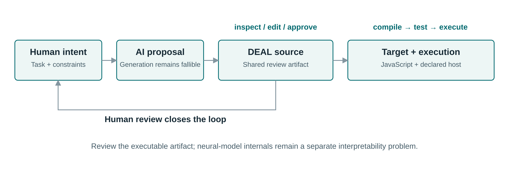
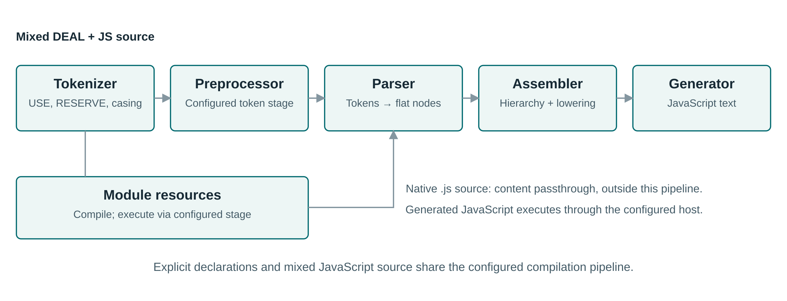
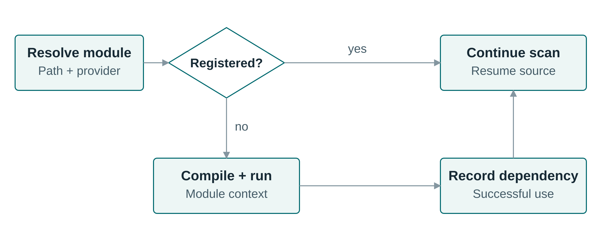
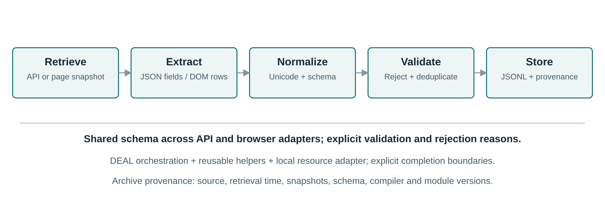
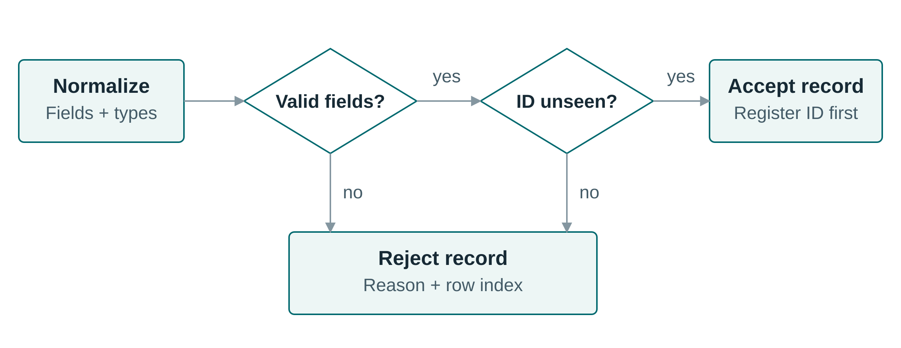
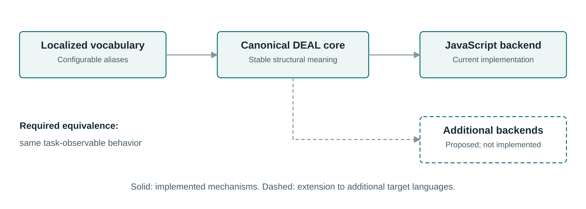
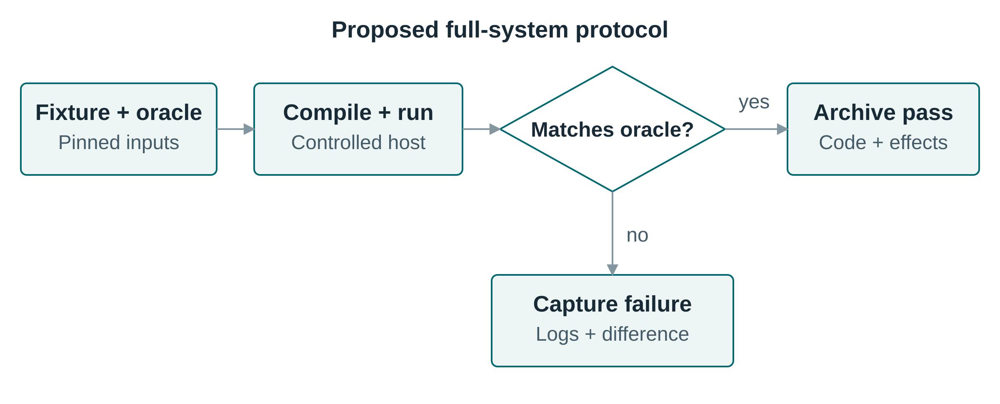

# DEAL.JS: An extensible language for inspectable human–AI research programming

Mohammad Fathi; Mehrdad CheshmeSohrabi; Ahmad Shabani; Ali Mansouri  
Department of Knowledge and Information Science, University of Isfahan, Isfahan, Iran

## Abstract

**Context:** AI-assisted programming can separate researchers' intentions from executable implementations that they can confidently inspect. A readable explanation alone does not make a computational workflow correct or reproducible.

**Objectives:** This study presents DEAL, the Declarative and Extensible Abstract Language, and its JavaScript-targeting realization, DEAL.JS, as a shared representation for human review, AI generation, and conventional execution.

**Methods:** We present the language model, source-to-source compilation architecture, and mechanisms for domain and vocabulary extension. A research-data extraction case demonstrates the composition of acquisition, preprocessing, validation, and storage. Analytical contracts characterize vocabulary equivalence and backend portability, while functional assertions assess the case's transformation and serialization rules.

**Results:** DEAL.JS integrates explicit control structures, reusable domain commands, adaptable vocabulary, contextual handlers, and embedded JavaScript through a five-stage compiler. The worked case makes data selection, exclusion, computation, and persistence decisions explicit. Nineteen case-validation assertions pass, yielding two accepted and three rejected synthetic records. These observations concern the application data contract rather than comparative usability or full-system performance.

**Conclusion:** DEAL.JS supplies an inspectable programming artifact and explicit extension boundaries for research-software workflows. Its contribution concerns the integration of domain notation, execution, and review, not neural-network interpretability. Controlled human studies, AI-generation comparisons, and full-system regression remain necessary to establish the intended collaboration benefits.

Keywords: human–AI collaboration; controlled languages; end-user programming; extensibility; compilation; reproducibility; web extraction.

## Introduction

Research programming occupies a distinctive position in software engineering: the person responsible for the scientific method may not be a professional programmer, yet must still judge whether software implements that method. End-user software engineering recognizes that people who program in service of another goal encounter requirements, design, testing, debugging, and maintenance problems ([Ko et al., 2011](https://researchdiscovery.drexel.edu/esploro/outputs/journalArticle/The-State-of-the-Art-in/991019167334204721) [1]). The breadth of end-user development research further indicates that access to a programming notation alone does not resolve the surrounding engineering demands ([Barricelli et al., 2019](https://expertise.unimi.it/resource/item/669695?language=en-US) [2]). For data-intensive research, the central challenge is to connect domain intent to a computational procedure that remains precise enough to execute and accessible enough to review.

AI-assisted code generation changes the production of software without removing the need to understand it. Users of a code-generation assistant have reported difficulty understanding, modifying, and debugging its suggestions ([Vaithilingam et al., 2022](https://dl.acm.org/doi/pdf/10.1145/3491101.3519665) [3]). Functional benchmarks evaluate generated programs through execution, and more extensive tests can reveal failures missed by smaller suites ([Chen et al., 2021](https://arxiv.org/abs/2107.03374) [4]; [Liu et al., 2023](https://proceedings.neurips.cc/paper_files/paper/2023/hash/43e9d647ccd3e4b7b5baab53f0368686-Abstract-Conference.html) [5]). These findings motivate a representational problem: the researcher, the AI system, and the runtime need a common program, not merely a natural-language request accompanied by unfamiliar implementation code.

DEAL, the Declarative and Extensible Abstract Language, provides this common representation through constrained, natural-language-like instructions, reusable domain commands, configurable vocabulary, and explicit control structures ([DEAL.JS](https://github.com/DEAL-X/DEAL-JS) [6]). DEAL.JS is its JavaScript-targeting implementation: it compiles DEAL instructions to JavaScript while allowing ordinary JavaScript within the same program ([DEAL.JS](https://github.com/DEAL-X/DEAL-JS) [6]). A researcher can express and review a workflow at the domain level, an AI system can generate or revise the same source, and the compiler produces the target program used for execution. Reliability is consequently treated as a relationship among intent, source, translation, dependencies, and observed behavior, rather than as an inherent consequence of English-like wording.

The design builds on established work in controlled natural languages and domain-specific language implementation ([Kuhn, 2014](https://aclanthology.org/J14-1005/) [7]; [Spinellis, 2001](https://www.spinellis.gr/pubs/jrnl/2000-JSS-DSLPatterns/html/dslpat.html) [8]). Its contribution is the integration of these ideas around a shared research-programming artifact: a stable structural language with adaptable vocabulary, domain modules, an incremental JavaScript adoption path, and inspectable translation. The important question is therefore not whether a program resembles prose, but how its representation exposes scientifically consequential decisions while retaining executable precision.

The article makes five contributions. First, it formulates a shared executable representation connecting researchers, AI systems, and conventional runtimes. Second, it presents the language model and compilation architecture, including explicit declarations and JavaScript interoperability. Third, it demonstrates how acquisition, extraction, preprocessing, validation, and storage compose into a reviewable research workflow. Fourth, it characterizes semantic conditions for vocabulary localization and backend reuse. Fifth, it develops an evaluation framework that separates translation correctness, application behavior, human comprehension, AI generation, and operational cost.

Three research questions guide the study. They address representation, extensibility, and the application of the language to research-software workflows.

- **RQ1:** Which representation and compiler mechanisms connect domain-level review with executable implementation?
- **RQ2:** Under what explicit conditions can vocabulary adaptation and alternative backends preserve observable behavior?
- **RQ3:** How can acquisition, extraction, preprocessing, and persistence be composed into a reviewable research workflow?

RQ1 is addressed through the language model and compiler architecture, RQ2 through conditional semantic contracts, and RQ3 through the worked application and its data-contract validation. The effects of these mechanisms on researcher comprehension and AI-generation success are separate empirical questions.

## Research problem and design rationale

### Three forms of opacity

The black-box problem arises at more than one level of an AI-assisted research system. At the model level, interpretability concerns the relationship between learned computation, predictions, and explanations; the literature cautions against treating these as a single property ([Lipton, 2018](https://vis.csail.mit.edu/classes/6.859/readings/pdfs/Lipton-TheMythosOfModelInterpretability.pdf) [9]; [Doshi-Velez and Kim, 2017](https://arxiv.org/abs/1702.08608) [10]). The distinction between an inherently interpretable model and an explanation attached to an opaque predictor is especially consequential for high-stakes decisions ([Rudin, 2019](https://www.nature.com/articles/s42256-019-0048-x) [11]). A programming language addresses a different, complementary level: the explicit procedure through which data are acquired, transformed, analyzed, and stored.

Three forms of opacity are therefore distinguished. Model opacity concerns internal learned computation; program opacity concerns the procedure embodied in source code; workflow opacity concerns the connection among sources, transformations, dependencies, and outputs. DEAL targets program and workflow opacity by placing consequential operations in an identifiable executable artifact. A neural-network prediction invoked by that artifact remains a model-interpretability problem, while its inputs, invocation conditions, and downstream use become part of the inspectable workflow.

This separation determines what the proposed solution must expose. Reviewers need to identify which observations enter an analysis, which transformations alter them, which criteria exclude records, and which effects occur outside the program. Domain-level commands make these decisions discussable, while their contracts and target implementations provide a route to more detailed inspection. Readability and computational evidence serve complementary roles.

### The communication gap

The proposed workflow assigns distinct responsibilities to its participants. The researcher defines the scientific goal and evaluates domain validity; the AI system proposes or revises a program; the compiler translates the program; and the runtime executes its operations. A shared source artifact connects these responsibilities without transferring scientific authority to the compiler or assuming that AI generation is correct.

Figure 1 illustrates the resulting review-and-execution loop. Its governing invariant is artifact identity: the approved source, generated target code, and execution record must refer to the same program configuration. The loop supports revision because a disagreement can be located in a domain rule, a command implementation, a translation, or an execution condition.



Figure 1. Shared executable representation linking researcher intent, AI-assisted revision, and target execution. The review loop preserves the connection between the approved program and its operational interpretation. AI assistance: Perplexity Computer (GPT 6.1 Sol), SVG-code preparation.

### Objectives and requirements

The language has seven objectives: reviewable intent, precise execution, incremental adoption, domain reuse, adaptable vocabulary, reproducibility, and reuse of the underlying model across implementation technologies. Table 1 connects each objective to a mechanism and a criterion by which its utility can be evaluated. This mapping makes the distinction between an implemented mechanism and its empirical benefit explicit.

Table 1. Design objectives, corresponding mechanisms, and evaluation criteria.

| Objective | DEAL design response | Criterion for evaluation |
|---|---|---|
| Reviewable research intent | Domain commands and explicit control structures | Correct comprehension and detection of seeded semantic errors |
| Precise execution | Constrained grammar and target-source generation | Agreement with independently specified observable behavior |
| Incremental adoption | Ordinary JavaScript alongside DEAL instructions | Completion of mixed-source tasks without unnecessary rewrites |
| Reusable domain knowledge | Commands and importable modules | Reuse across tasks with documented input/output contracts |
| Adaptable human vocabulary | Replacement reserves and optional readability words | Semantic equivalence across vocabulary configurations |
| Research reproducibility | Executable workflow plus versioned inputs and dependencies | Re-execution from archived materials with matching relevant outputs |
| Cross-language reuse of the model | Separation of language concepts from backend implementation | Equivalent behavior on a declared portable subset |

Reproducible computational research requires recording inputs, program versions, parameters, and intermediate results, and executable workflow descriptions can reduce divergence between documentation and performed analysis ([Sandve et al., 2013](https://journals.plos.org/ploscompbiol/article?id=10.1371/journal.pcbi.1003285) [12]). FAIR principles also emphasize interoperability, explicit vocabularies, provenance, and reuse across human and machine consumers ([Wilkinson et al., 2016](https://www.nature.com/articles/sdata201618) [13]). DEAL can support these objectives through a common program representation, but a language alone is neither a provenance system nor a certification of FAIR compliance.

## Related work and comparative positioning

### Controlled language and programming accessibility

Controlled natural languages constrain vocabulary and grammar to balance human accessibility with formal precision ([Kuhn, 2014](https://aclanthology.org/J14-1005/) [7]). DEAL applies this principle to research programming: familiar words form explicit constructions rather than unrestricted instructions interpreted by a language model at runtime. Users work with a defined programming language whose domain vocabulary can be extended without abandoning its structural core.

Syntax is a legitimate design variable, but not a sufficient explanation of usability. Stefik and Siebert report empirical differences in novice performance across programming-language syntaxes, supporting evidence-based rather than tradition-based syntax decisions ([Stefik and Siebert, 2013](https://eric.ed.gov/?id=EJ1042402) [14]). A later replication supports the view that some familiar keywords are unintuitive to novices while cautioning that intuitive keywords alone do not make programming easy ([Lappi et al., 2023](https://link.springer.com/article/10.1007/s11219-023-09631-7) [15]). DEAL's readability should consequently be evaluated through actual comprehension and editing tasks rather than inferred from its use of familiar words.

The Cognitive Dimensions framework identifies closeness of mapping, hidden dependencies, diffuseness, and error-proneness as relevant dimensions of notation design ([Green and Petre, 1996](https://history.futureofcoding.org/history/msg_files/F6R/F6R1A64AF.pdf) [16]). These dimensions reveal a central trade-off in DEAL: a domain command can shorten the distance between a scientific procedure and its code, but contextual state can make dependencies less visible. Vocabulary adaptation must therefore preserve access to canonical operations and their contracts.

A systematic review of programmers' mental models connects program comprehension with information needs, available evidence, prior knowledge, mental simulation, and reasoning about behavior ([Heinonen et al., 2023](https://www.sciencedirect.com/science/article/pii/S0950584923001544) [17]). This motivates evaluating whether a reviewer forms a correct behavioral model of a DEAL program, rather than asking only whether its keywords appear familiar.

SmellDSL provides a language-evaluation precedent by examining specification effort, correctness, and error rate for a domain-specific notation ([Keemps et al., 2025](https://www.sciencedirect.com/science/article/abs/pii/S0950584925000990) [18]). For DEAL, corresponding outcomes concern the accuracy with which researchers understand and revise data workflows. This places the contribution within software-engineering evaluation rather than restricting it to syntactic description.

### English-like scripting and extensible languages

_hyperscript is a close comparator because it combines English-like, HyperTalk-inspired notation with first-class selectors, asynchronous transparency, and JavaScript-defined extensions ([official _hyperscript documentation](https://hyperscript.org/) [19]). Its collection loops, fetching operations, and JavaScript interoperability show that readable web interaction is an established language-design direction ([official _hyperscript reference](https://hyperscript.org/reference/) [20]). DEAL's distinctive emphasis is a shared research-program artifact with explicit target-source generation and vocabulary configuration, not a claim to have invented English-like web commands.

LiveCode supplies another important precedent for command-oriented programming and explicit block endings. Its `repeat for each` forms cover text chunks, array elements, and array keys ([LiveCode documentation](https://docs.livecode.com/docs/LiveCode%20Script/Control%20Structures/repeat/) [21]). These constructs show why readability must be compared at the level of data representation and task semantics: iterating through comma-delimited text and through an array are not automatically equivalent operations.

SugarJ addresses a different dimension: imported sugar libraries can introduce grammar productions and desugaring rules, composing extensions within a host-language setting ([Erdweg et al., 2011](https://www.pl.informatik.uni-mainz.de/files/2019/04/sugarj.pdf) [22]). DEAL's `RESERVE` mechanism is a lighter vocabulary adaptation mechanism within an established structural language ([DEAL.JS documentation](https://github.com/DEAL-X/DEAL-JS) [6]). The comparison concerns extension boundaries and implementation burden, not an assertion that lexical aliases have the expressive power of arbitrary grammar extension.

### Web extraction and executable AI reasoning

WebL established web-document processing as a language-level task, combining service combinators for retrieval with a markup algebra for extraction and manipulation ([Kistler and Marais, 1998](https://www.ra.ethz.ch/cdstore/www7/1832/com1832.htm) [23]). A later survey documents the breadth of web-data extraction and opportunities to reuse techniques across application domains ([Ferrara et al., 2014](https://arxiv.org/abs/1207.0246) [24]). Scraping is therefore a demanding application through which to demonstrate DEAL's integration, not itself a new contribution.

PAL provides a relevant human–AI architectural precedent: a language model generates a program, and a conventional interpreter performs the computation ([Gao et al., 2023](https://proceedings.mlr.press/v202/gao23f.html) [25]). PICARD and grammar-constrained decoding show how formal restrictions can guide model output toward structurally valid representations ([Scholak et al., 2021](https://aclanthology.org/2021.emnlp-main.779/) [26]; [Geng et al., 2023](https://aclanthology.org/2023.emnlp-main.674/) [27]). DEAL provides a candidate representation for such integrations; it does not follow that a model already generates DEAL more accurately than a familiar general-purpose language.

Assurance of AI-written software also depends on the relationship among human objectives, supervisory mechanisms, and validation evidence. A single-case preprint examines these relationships while reporting limitations of supervision in practice ([Ferris and Bonilla, 2026, preprint](https://arxiv.org/html/2610.08651v1) [28]). DEAL contributes a representational component to this broader problem: an explicit program against which intent and behavior can be compared.

### Limitations addressed by the integrated design

Existing languages address different parts of the problem. General-purpose languages offer expressive power and ecosystems; English-like scripting languages prioritize human-oriented interaction; extensible languages support new notation; and extraction languages integrate web-document operations. Table 2 identifies the additional integration required to obtain a common research-facing representation. DEAL addresses this integration through its combination of structural notation, domain commands, adaptable vocabulary, and JavaScript interoperability.

Table 2. Established approaches and the integration problem addressed by DEAL.

| Approach | Established strength | Work otherwise left to the user | DEAL response |
|---|---|---|---|
| JavaScript | Target-language execution and rich host integration ([DEAL.JS](https://github.com/DEAL-X/DEAL-JS) [6]) | Organize low-level operations into a research-facing review vocabulary | Layer domain commands over inspectable target code |
| Python | Direct sequence iteration and conventional program structure ([Python documentation](https://docs.python.org/3/tutorial/controlflow.html) [29]) | Coordinate library-specific APIs and distinguish workflow intent from implementation detail | Offer a common command-oriented orchestration surface |
| _hyperscript | English-like web scripting, selectors, async transparency ([official documentation](https://hyperscript.org/) [19]) | Establish research-specific data contracts and provenance conventions | Emphasize a versioned research program and generated target artifact |
| LiveCode | Human-oriented commands and chunk/array operations ([official documentation](https://docs.livecode.com/docs/LiveCode%20Script/Control%20Structures/repeat/) [21]) | Reconcile its execution and data model with a JavaScript-oriented environment | Preserve a mixed-JavaScript adoption path |
| SugarJ | Composable syntax extensions and desugaring ([OOPSLA paper](https://www.pl.informatik.uni-mainz.de/files/2019/04/sugarj.pdf) [22]) | Engineer grammar extensions when only vocabulary adaptation is required | Separate lightweight vocabulary changes from structural grammar changes |
| WebL | Integrated web retrieval and markup processing ([original paper](https://www.ra.ethz.ch/cdstore/www7/1832/com1832.htm) [23]) | Connect extraction notation to a broader human–AI review and localization workflow | Treat extraction as one reusable domain module |

The resulting contribution is architectural rather than a claim that earlier languages lack readable programs or reusable libraries. JavaScript and Python remain important alternatives because equivalent domain APIs can be built in either. The evaluation must therefore isolate the effect of DEAL's representation from the benefits of its libraries.

## Research design and analytical framework

The study adopts a design-science approach, relating a research-programming problem to a language artifact, its design rationale, and an application demonstration ([Hevner et al., 2004](https://aisel.aisnet.org/misq/vol28/iss1/6/) [30]). The unit of analysis is the executable workflow: a program whose domain operations, control flow, data decisions, and execution effects can be examined together. The analysis distinguishes properties of the representation from behavioral outcomes that require participant or comparative experiments.

The artifact is a working JavaScript-targeting language implementation, and the study examines its design and application rather than an implementation roadmap. The analytical component addresses three relationships: domain intent to explicit program structure, vocabulary variation to canonical operations, and program structure to target-language execution. Compilation determinism and semantic preservation are formalized as contracts over source, vocabulary, dependencies, configuration, and runtime observations.

The application component uses a synthetic catalog to demonstrate retrieval-to-storage composition. Five records exercise valid transformations, duplicate identifiers, missing numeric data, a boundary value of zero, and an invalid discount. Functional validation comprises 19 assertions over preprocessing, serialization, provenance fields, a document-shaped test double, and an in-memory storage connector. The assertions were executed with Node.js 20.20.2; compiler execution, live extraction accuracy, and human performance were not measured in this experiment.

The case-study helper and test code were prepared with assistance from Perplexity Computer (GPT 6.1 Sol). Inputs, rules, code, and recorded outputs accompany the article so that the functional checks can be inspected and repeated. Broader validation requirements are specified in the evaluation framework.

## Language design and syntax

### Design principles

Five principles organize the design: intent-oriented abstraction, explicit compilation, hybrid interoperability, modular extensibility, and reusable operations. These principles assign different review obligations rather than guaranteeing a universally easier notation. A domain expert must inspect the scientific operation and data policy, a language implementer must preserve its specified meaning, and a host integrator must expose the resources needed to execute it.

Sequencing, loops, assignments, and ordinary JavaScript make DEAL.JS a hybrid language, despite “declarative” appearing in its name ([DEAL.JS documentation](https://github.com/DEAL-X/DEAL-JS) [6]). Intent-oriented commands can hide incidental mechanics, but they do not eliminate state or control flow. Nor does source generation alone establish optimization, security, or correctness.

### The four-part language model

DEAL is organized around four complementary concepts: structures, commands, reserves, and handlers, with conventional JavaScript available within the same source ([DEAL.JS documentation](https://github.com/DEAL-X/DEAL-JS) [6]). Structures define computation and control flow, commands encapsulate operations, reserves adapt the vocabulary, and handlers provide access to the computational context. Table 3 summarizes the constructs most relevant to research automation.

Table 3. Core language mechanisms and representative syntax.

| Mechanism | Representative syntax | Computational role |
|---|---|---|
| Declaration | `ASSUME CONST threshold IS 10;` | Bind a constant; related forms select `let` or `var` |
| Branching | `IF condition, procedure; ELSE procedure;` | Make a decision explicit |
| Iteration | `FOR EACH item OF items, procedure;` | Iterate over collection values; `IN` denotes a different operation |
| Conditional repetition | `WHILE condition, procedure;` | Repeat while a condition holds; ordinary JavaScript `do ... while` remains available |
| Grouping | `BEGIN ... END;` or `DO ... END;` | Delimit a procedure block |
| Callable block | `DOING ... END;` | Represent a callable computation |
| Failure handling | `TRY ... CATCH err, ... FINALLY ...;` | Separate normal execution, recovery, and cleanup |
| Continuations | `THEN`, `OTHERWISE`, `ANYWAY` | Express success, rejection, and finalization paths |
| Promise construction | `WILL procedure THEN procedure;` | Introduce a promise-oriented computation |
| Function command | `COMMAND clean(value = "") { ... }` | Register a reusable operation |
| Definition command | `COMMAND settings = { ... };` | Register a reusable value or object |
| Action command | `# task BEGIN ... END;` | Define and immediately invoke a repeatable action |
| Delegation | `const #dataset = value;` | Register a case-adapted identifier |
| Vocabulary replacement | `RESERVE into AS ",";` | Map vocabulary to a canonical token sequence |
| Readability word | `RESERVE the;` | Admit a word with no added computation |
| Module inclusion | `USE scraper;` | Introduce domain vocabulary and implementation |
| Collection operators | `WHERE`, `ORDER BY`, `LIMIT` | Filtering, ordering, and range selection |
| Context handlers | `DOCUMENT`, `RESPONSE`, `LOADED`, `FETCHED`, `ITS` | Refer to the current workspace or operation |

The forms in Table 3 follow the documented language; it is not a complete normative grammar ([DEAL.JS documentation](https://github.com/DEAL-X/DEAL-JS) [6]). A normative specification should additionally define precedence, name resolution, argument binding, scope, error conditions, and the observable contract of each library command. For research use, these contracts matter as much as the surface notation.

Readable operators include `BE` for assignment, `IS` for equality, `EQUALS` for strict equality, and `AND`/`OR` for logical conjunction/disjunction, with context-specific interpretation inside declarations ([DEAL.JS documentation](https://github.com/DEAL-X/DEAL-JS) [6]). Domain vocabulary can also express record projection and construction through operations such as `SELECT` and `COLLECT` ([DEAL.JS documentation](https://github.com/DEAL-X/DEAL-JS) [6]). Familiar wording does not replace an operator contract: coercion, field names, missing-value handling, and argument order remain computational decisions.

### Explicit declarations and ordinary source

The `ASSUME` construction makes binding intent explicit: `CONST` declares a constant, `VAR` selects a variable declaration, and `LET` or an omitted modifier selects a lexical binding ([DEAL.JS documentation](https://github.com/DEAL-X/DEAL-JS) [6]). Listing 1 pairs the DEAL forms with their JavaScript equivalents, illustrating how readable declarations retain familiar target-language distinctions.

```text
ASSUME CONST threshold IS 10;
ASSUME VAR attempts IS EQUAL 0;
ASSUME LET accepted BE [];
ASSUME completed EQUALS false;
```

```javascript
const threshold = 10;
var attempts = 0;
let accepted = [];
let completed = false;
```

Listing 1. Explicit declarations make binding intent visible while retaining conventional JavaScript declarations as an alternative ([DEAL.JS documentation](https://github.com/DEAL-X/DEAL-JS) [6]). The keyword `ASSUME` denotes a binding construction here; it is not a probabilistic assertion or a formal proof assumption.

Hybrid source is an important adoption mechanism. A researcher can use a domain command for a recurrent operation while leaving a specialized mathematical expression or object transformation in JavaScript. The objective is not to restate every operator in prose, but to place an appropriate abstraction boundary between research decisions and implementation details.

### Commands and document-like notation

Commands support actions, functions, definitions, and delegated identifiers, with functional and sentence-like invocation forms ([DEAL.JS documentation](https://github.com/DEAL-X/DEAL-JS) [6]). Listing 2 illustrates a research-specific normalization command. The computation remains ordinary JavaScript inside the reusable command, separating its implementation from the domain-level name used in a workflow.

```text
COMMAND cleanTitle(value = "") {
    return String(value).normalize("NFKC")
        .replace(/\s+/gu, " ").trim();
}

ASSUME CONST title IS cleanTitle("  Alpha   study ");
```

Listing 2. An author-defined command exposing a clearly named preprocessing operation. The example's contract is Unicode NFKC normalization, whitespace collapse, and trimming; the name alone is not the specification.

Document-like notation includes selected Markdown-style list markers and emphasis conventions; heading-like action definitions execute immediately after definition ([DEAL.JS documentation](https://github.com/DEAL-X/DEAL-JS) [6]). This allows a procedure to combine navigable presentation with executable structure. An executable heading nevertheless denotes an action, so a programming environment must distinguish actions, comments, declarations, and data.

Case behavior is similarly selective. Documented language vocabulary is case-adapted, ordinary user identifiers remain case-sensitive unless registered, and property names after a dot retain their own spelling rules ([DEAL.JS documentation](https://github.com/DEAL-X/DEAL-JS) [6]). A consistent programming interface therefore depends on explicit identifier conventions rather than a blanket claim that all source is case-insensitive.

## Compiler architecture and execution model

### Configured compilation pipeline

The DEAL.JS compiler is implemented in C# and uses a five-stage source-to-source pipeline: tokenization, preprocessing, parsing, assembly, and generation ([engine source](https://github.com/DEAL-X/DEAL-JS/blob/d76dcae3bf157e3969be0bd1f98ed2522defc2b9/DEAL.JS/Engine.cs) [31]). It extends a JavaScript-oriented engine, while a generic orchestration layer applies the stage transformations and delegates execution to a configurable host ([Engine framework](https://github.com/DEAL-X/Engine) [32]). Figure 2 shows how these responsibilities connect without merging compilation with execution.



Figure 2. DEAL.JS compilation and execution architecture. DEAL source enters the five-stage transformation pipeline; recognized `.js` inputs follow the native-content passthrough branch. Domain modules and resource bindings support compilation and host execution, while execution remains distinct from generating JavaScript ([engine source](https://github.com/DEAL-X/DEAL-JS/blob/d76dcae3bf157e3969be0bd1f98ed2522defc2b9/DEAL.JS/Engine.cs) [31]; [Engine framework](https://github.com/DEAL-X/Engine) [32]). AI assistance: Perplexity Computer (GPT 6.1 Sol), SVG-code preparation.

The tokenizer recognizes source elements and vocabulary adaptations, including module inclusion and reserve handling; the preprocessor provides the configured token-processing position ([tokenizer source](https://github.com/DEAL-X/DEAL-JS/blob/d76dcae3bf157e3969be0bd1f98ed2522defc2b9/DEAL.JS/Tokenizer.cs) [33]; [DEAL.JS source](https://github.com/DEAL-X/DEAL-JS) [6]). The parser classifies tokens into nodes, including declaration and block structures, while the assembler constructs and lowers their computational organization ([DEAL.JS source](https://github.com/DEAL-X/DEAL-JS) [6]). JavaScript generation is inherited through the language's generator extension ([DEAL.JS source](https://github.com/DEAL-X/DEAL-JS) [6]). This is a source-to-source architecture, not a neural translation step inside the compiler.

JavaScript interoperability has two paths. Mixed DEAL/JavaScript programs pass through the language pipeline, whereas an input identified by a nonempty `.js` source path is returned without DEAL transformation ([engine source](https://github.com/DEAL-X/DEAL-JS/blob/d76dcae3bf157e3969be0bd1f98ed2522defc2b9/DEAL.JS/Engine.cs) [31]). This distinction permits existing JavaScript modules to be reused without requiring their operations to be rewritten in DEAL notation.

### Representations and stage contracts

The stage interface accepts and returns `object`, with each stage interpreting its input as the corresponding token, node, program, or source representation ([Engine framework](https://github.com/DEAL-X/Engine) [32]). Table 4 relates these transitions to semantic preservation requirements. The contracts describe responsibilities of the stages rather than a statically enforced pipeline type system.

Table 4. Compilation stages, intermediate representations, and semantic preservation requirements.

| Stage | Representation transition | Review obligation |
|---|---|---|
| Tokenizer | Source text to positioned tokens ([implementation](https://github.com/DEAL-X/DEAL-JS/blob/d76dcae3bf157e3969be0bd1f98ed2522defc2b9/DEAL.JS/Tokenizer.cs) [33]) | Preserve literals and distinguish vocabulary from user identifiers |
| Preprocessor | Tokens to a token array; default token processing is pass-through ([framework](https://github.com/DEAL-X/Engine) [32]) | Make any configured rewrite explicit |
| Parser | Tokens to locally classified nodes ([implementation](https://github.com/DEAL-X/DEAL-JS) [6]) | Preserve statement categories and declaration intent |
| Assembler | Nodes to a hierarchical, node-derived program ([framework](https://github.com/DEAL-X/Engine) [32]) | Preserve grouping, scope, and continuation attachment |
| Generator | Program structure to JavaScript source ([implementation](https://github.com/DEAL-X/DEAL-JS) [6]) | Preserve operations and expose inspectable target code |
| Executor | Generated source to host-defined results and effects ([framework](https://github.com/DEAL-X/Engine) [32]) | Check permissions, effects, failures, and completion |

Tokens carry type, value, and position, while nodes add children, a parent relation, and structural flags; walkers support traversal of these representations ([Engine framework](https://github.com/DEAL-X/Engine) [32]). These abstractions provide attachment points for future source-linked explanations and instrumentation. Their presence is not evidence that complete source maps or diagnostic-location accuracy have already been validated.

### Modules, commands, and runtime boundaries

The implementation maintains command dictionaries and reserve mappings, and `USE` resolves dependency resources through the language and general engine infrastructure ([engine source](https://github.com/DEAL-X/DEAL-JS/blob/d76dcae3bf157e3969be0bd1f98ed2522defc2b9/DEAL.JS/Engine.cs) [31]; [tokenizer source](https://github.com/DEAL-X/DEAL-JS/blob/d76dcae3bf157e3969be0bd1f98ed2522defc2b9/DEAL.JS/Tokenizer.cs) [33]; [generic engine implementation](https://github.com/DEAL-X/Engine/blob/8800695b1bbe6274f71f581473943ff7943d5036/Engine/Engine.cs) [34]). A domain module therefore combines vocabulary with implementation resources; reproducibility requires recording its version and the order and environment in which it is resolved.

Compilation and execution remain separate responsibilities. A ClearScript V8 host provides one execution environment, exposing the engine and selected host facilities; the execution-stage interface also permits alternative host implementations ([execution environment](https://github.com/DEAL-X/Environment) [35]; [Engine framework](https://github.com/DEAL-X/Engine) [32]). Reusing generated JavaScript therefore requires compatible host APIs and dependencies, whether the deployment uses a browser, Node.js, or an embedded runtime.

The local-resource module exposes `file`, `folder`, `save`, `append`, `prepend`, `delete`, and `exists` operations through a resource provider ([local-resource interface](https://github.com/DEAL-X/DEAL-JS/blob/d76dcae3bf157e3969be0bd1f98ed2522defc2b9/Library/deal/data/local.djs) [36]). Its `local.save(object, path)` operation delegates to the host's `SetFileContents(path, object)` interface ([local-resource interface](https://github.com/DEAL-X/DEAL-JS/blob/d76dcae3bf157e3969be0bd1f98ed2522defc2b9/Library/deal/data/local.djs) [36]). Making the argument contract explicit keeps the direction of data flow visible across the language–host boundary.

Module resolution maps an extensionless name to `.deal`, `.djs`, or `.js` resources; directory-based modules may use an index or traverse their entries ([module-resolution implementation](https://github.com/DEAL-X/DEAL-JS/blob/d76dcae3bf157e3969be0bd1f98ed2522defc2b9/DEAL.JS/Tokenizer.cs) [33]). A resource not already registered is compiled and executed before successful dependency inclusion is recorded ([dependency interface](https://github.com/DEAL-X/Engine/blob/8800695b1bbe6274f71f581473943ff7943d5036/Engine/Engine.cs) [34]). Figure 3 illustrates the successful inclusion paths and the distinction between first use and reuse.



Figure 3. Successful dependency-loading paths after resource resolution. A previously registered path avoids re-loading; first use passes through compilation and execution before dependency registration and resumed scanning ([module resolution](https://github.com/DEAL-X/DEAL-JS/blob/d76dcae3bf157e3969be0bd1f98ed2522defc2b9/DEAL.JS/Tokenizer.cs) [33]; [dependency management](https://github.com/DEAL-X/Engine/blob/8800695b1bbe6274f71f581473943ff7943d5036/Engine/Engine.cs) [34]). AI assistance: Perplexity Computer (GPT 6.1 Sol), SVG-code preparation.

Module loading belongs to the research trust boundary because imported operations can introduce effects as well as vocabulary. Reproducible deployment therefore requires identifiable dependency versions, explicit host bindings, and controlled resource access. The ClearScript host exposes .NET facilities, so isolation and permission policies must be established by the deployment rather than inferred from readable syntax ([execution environment](https://github.com/DEAL-X/Environment) [35]).

The generic diagnostic model contains identifiers, severity, source and range information, whereas `Output.Errors` records error strings and orchestration emits log events ([Engine framework](https://github.com/DEAL-X/Engine) [32]). These channels should not be conflated with a validated end-to-end repair interface. A future AI-repair experiment must record the actual diagnostic payload received by the model and measure whether the repaired program satisfies an independent oracle.

### Determinism, preservation, and reproducibility

We describe compilation using the analytical function

\[
C_b(s,v,m,o,\sigma_0)=j_b, \qquad (1)
\]

where \(s\) is source, \(v\) is vocabulary configuration, \(m\) comprises ordered module versions and contents, \(o\) includes compiler configuration, \(\sigma_0\) captures initial compilation state, and \(b\) identifies the backend. Together these terms define the compilation context \(\kappa\). The determinism contract requires identical target output for identical source and context, including any influential module-initialization inputs. It does not require external data sources or randomized analyses to remain unchanged.

Translation correctness requires an additional relation:

\[
\operatorname{Obs}(\operatorname{Exec}_b(C_b(s,\kappa),e))
=\operatorname{Spec}(s,e), \qquad (2)
\]

where \(e\) identifies the controlled execution environment and observations include outputs, errors, persistent changes, and relevant event order. The right-hand side must come from an independent specification or oracle. Agreement with a compiler's own generated output is insufficient as the only correctness criterion.

Research reproducibility extends the record to input snapshots, runtime and module versions, external responses, random seeds, locale, and permissions. This distinction follows the broader requirement to archive complete computational workflows and their influential settings ([Sandve et al., 2013](https://journals.plos.org/ploscompbiol/article?id=10.1371/journal.pcbi.1003285) [12]). DEAL contributes a reviewable program within that record, not an exemption from recording the surrounding environment.

## Worked application: web retrieval to research-ready storage

### Task and data model

Consider a research workflow that monitors a structured catalog. The workflow retrieves a page or API response, extracts records, normalizes fields, computes a derived variable, validates constraints, removes duplicate identifiers, and stores accepted records separately from rejection reasons. DEAL.JS combines retrieval, selection, transformation, and output operations within a common orchestration surface ([DEAL.JS documentation](https://github.com/DEAL-X/DEAL-JS) [6]). The complete application has the compositional form

\[
\mathcal{W}(u)=S\bigl(Q\bigl(N\bigl(X\bigl(A(u)\bigr)\bigr)\bigr)\bigr), \qquad (3)
\]

where \(A\) acquires a source \(u\), \(X\) extracts fields, \(N\) normalizes and derives variables, \(Q\) validates and deduplicates records, and \(S\) serializes and stores outputs. The output includes both accepted records and rejection reasons. This decomposition leaves domain policies visible while allowing acquisition and storage implementations to be replaced independently.

The demonstration uses five synthetic records selected to exercise distinct data policies. A valid record has a nonempty identifier and title, a finite nonnegative main price, a finite discount in \([0,1]\), and a nonnegative integer quantity. The derived net price is

\[
p_{\mathrm{net}}=\operatorname{round}_{2}\bigl(p_{\mathrm{main}}(1-d)\bigr). \qquad (4)
\]

Missing numeric data are rejected rather than converted to zero. Duplicate handling retains the first valid occurrence of an identifier, so an invalid row does not prevent a later valid row with the same identifier from being accepted.

| Input record | Main price | Discount | Quantity | Required outcome |
|---|---:|---:|---:|---|
| `p1`, padded title `Alpha study` | 100 | 0.10 | 2 | Accept; normalized title; net price 90 |
| Duplicate `p1` | 100 | 0.10 | 2 | Reject as duplicate |
| `p2`, full-width initial character in `Ｂeta study` | 0 | 0 | 0 | Accept as `Beta study`; preserve zero price and quantity |
| `p3`, missing main price | Missing | 0 | 1 | Reject as invalid |
| `p4`, discount outside the permitted interval | 10 | 1.25 | 1 | Reject as invalid |

Table 5. Input conditions and expected outcomes in the synthetic catalog. The zero-valued record distinguishes a valid numeric zero from a missing value.

Figure 4 separates the five responsibilities. Retrieval may change between an API and a browser adapter, but the normalization, validation, and storage contract remains the same. This separation supports scientific review because a researcher can inspect both what was acquired and which records were transformed or excluded.



Figure 4. Research-data workflow expressed through DEAL orchestration and reusable implementations. Accepted records retain provenance fields and rejected records retain source-row identifiers and reasons. Snapshot hashes, acquisition logs, and version manifests supplement the pipeline when it is used in a reproducible study. AI assistance: Perplexity Computer (GPT 6.1 Sol), SVG-code preparation.

### Acquisition and extraction

The scraper vocabulary includes `FETCH` for request/response interaction, `LOAD` for loading a page into the active context, selectors such as `ALL`, and contextual identifiers including `DOCUMENT`, `RESPONSE`, `LOADED`, and `FETCHED` ([DEAL.JS documentation](https://github.com/DEAL-X/DEAL-JS) [6]). Listing 3 expresses retrieval, selection, and output in one sequence. Its `sources` and `destination` parameters identify the acquisition targets and output location.

```text
USE deal;
USE scraper;
FOR EACH url OF sources,
    LOAD url,
    THEN APPEND ALL "h3.title", TO destination;
```

Listing 3. Retrieval, title selection, and output through the load-select-append idiom ([DEAL.JS documentation](https://github.com/DEAL-X/DEAL-JS) [6]). A multi-source workflow additionally requires an explicit completion and context-isolation policy.

For the structured case, an author-defined JavaScript helper receives a document and source identifier explicitly. It selects `table.catalog tbody tr`, reads each row's `data-id`, and retrieves `.title`, `.price`, `.discount`, and `.quantity` fields. This avoids using a contextual handler inside the normalization implementation and keeps selectors separate from scientific processing rules.

An API-first variant should convert the response into the same plain-record schema before normalization. With a standard JavaScript `Response`, JSON parsing is asynchronous and must be awaited or returned within the promise chain; promise chaining and aggregation provide explicit completion boundaries ([MDN promise guide](https://developer.mozilla.org/en-US/docs/Web/JavaScript/Guide/Using_promises) [37]). API and DOM extraction are interchangeable only after their adapters satisfy the same input schema, not merely because they refer to the same page.

### Preprocessing, processing, and persistence

Listing 4 composes the single-page workflow. Domain-specific functions extract records, apply the data contract, and serialize accepted output; `cleanRecords` wraps normalization in a reusable DEAL command. Persistence uses the `local` resource interface, keeping storage effects explicit at the orchestration level ([local-resource interface](https://github.com/DEAL-X/DEAL-JS/blob/d76dcae3bf157e3969be0bd1f98ed2522defc2b9/Library/deal/data/local.djs) [36]).

```text
USE deal;
USE scraper;
USE deal/data/local;
USE "./deal-case-helpers.js";

COMMAND cleanRecords(rows = [], source = "", time = "") {
    return normalizeRecords(rows, source, time);
}

ASSUME CONST sourceURL IS "https://example.org/catalog";
ASSUME CONST destination IS "results/catalog.jsonl";

LOAD sourceURL,
THEN BEGIN
    ASSUME CONST capturedAt IS new Date().toISOString();
    ASSUME CONST rawRows IS extractRows(DOCUMENT, sourceURL);
    ASSUME CONST report IS cleanRecords(rawRows, sourceURL, capturedAt);
    local.save(toJSONL(report.accepted), destination);
    local.save(JSON.stringify(report.rejected), "results/rejected.json");
END;
OTHERWISE BEGIN
    throw new Error("Retrieval failed: " + sourceURL);
END;
```

Listing 4. DEAL.JS orchestration for acquisition, normalization, validation, and storage. The domain functions are defined for the case study; `example.org` represents a configurable endpoint rather than a measured acquisition source.

The helper explicitly separates validation from duplicate detection and only marks an identifier as seen after validation succeeds. Thus an invalid earlier record does not prevent acceptance of a later valid record with the same identifier. Unicode normalization, whitespace collapse, interval checks, numeric finiteness, and integer quantity checks are operational rules that a domain researcher can review independently of the orchestration.

Persistent output uses JSON Lines for accepted records and a separate rejection log. Each accepted record carries `source_url`, `retrieved_at`, and `schema_version`; a complete research run should also archive the raw response, content hash, module manifest, compiler version, and permissions or acquisition conditions. These additions operationalize the provenance and reuse concerns emphasized in reproducibility and FAIR guidance ([Sandve et al., 2013](https://journals.plos.org/ploscompbiol/article?id=10.1371/journal.pcbi.1003285) [12]; [Wilkinson et al., 2016](https://www.nature.com/articles/sdata201618) [13]).

Persistence can be separated from document manipulation through a connector interface: the JavaScript `ChainDoc` layer supports connector-based storage and row/line access ([DEAL.JS library](https://github.com/DEAL-X/DEAL-JS) [6]). An in-memory connector is used in the case-validation experiment to isolate serialization and storage behavior from filesystem and network variability.

### Data contracts and rejection semantics

Table 6 specifies the application's preprocessing and storage rules. These rules belong to the domain contract rather than the language grammar. A researcher can therefore review them independently of the page or API that supplies the raw fields.

Table 6. Accepted-record schema and rejection policy for the synthetic case.

| Field or decision | Contract | Rationale or limitation |
|---|---|---|
| `id`, `title` | Trim identifier; normalize title with NFKC and collapsed whitespace; require both | Full-width characters normalize; identifier case is not changed |
| `main_price`, `discount` | Finite price at least zero; finite discount in [0, 1] | Missing/blank is invalid, not silently coerced to zero |
| `quantity`, `net_price` | Nonnegative safe-integer quantity; net price rounded to two decimal places | Valid zeros survive; rounding is an explicit case policy |
| Duplicate detection | Retain the first valid record per identifier | Invalid records do not reserve an identifier |
| Provenance | `source_url`, `retrieved_at`, `schema_version` on accepted rows | The test timestamp is synthetic; it proves no retrieval event |
| Rejected records | One-based `source_row` and reason `invalid` or `duplicate` | A compact rejection log; raw inputs require separate preservation |

Figure 5 shows the ordering that matters for duplicate handling. Validation precedes insertion into the seen-identifier set, so reversing these steps would change behavior. Retaining raw snapshots separately remains necessary because the compact rejection log cannot reconstruct excluded source data.



Figure 5. Record validation in the application data contract. Invalid fields or a previously accepted identifier cause rejection; otherwise, the identifier is registered and the record enters the accepted output. Validation therefore precedes duplicate registration. AI assistance: Perplexity Computer (GPT 6.1 Sol), SVG-code preparation.

### Completion and failure policy

Asynchronous readability should not erase ordering requirements. DEAL's continuation suffixes map to JavaScript promise methods, and the underlying success and failure paths should therefore be reviewed in terms of promise completion rather than assumed multithreading ([assembler source](https://github.com/DEAL-X/DEAL-JS/blob/d76dcae3bf157e3969be0bd1f98ed2522defc2b9/DEAL.JS/Assembler.cs) [38]; [MDN promise guide](https://developer.mozilla.org/en-US/docs/Web/JavaScript/Guide/Using_promises) [37]). A run is complete only when retrieval, normalization, and all required persistence have completed.

The single-page example avoids concurrent mutation of `DOCUMENT`. Multi-page use should either await each page sequentially or provide isolated document contexts and aggregate all returned promises. A research protocol should also define bounded retries, timeouts, rejection propagation, partial-output policy, and stable identifiers for reruns; merely printing a success message after launching asynchronous requests is not an adequate completion criterion.

## Comparative examples and contribution analysis

### Matched collection task

Listing 5 compares a common task: output the elements of a three-value collection in order. DEAL expresses the loop with readable structural keywords, JavaScript and Python use their ordinary iteration constructs, and _hyperscript uses an English-like collection loop ([DEAL.JS](https://github.com/DEAL-X/DEAL-JS) [6]; [Python iteration](https://docs.python.org/3/tutorial/controlflow.html) [29]; [_hyperscript iteration](https://hyperscript.org/reference/) [20]). The comparison isolates representation while keeping the computational intent stable.

```text
// DEAL.JS
ASSUME CONST values IS [1, 2, 3];
FOR EACH value OF values, BEGIN
    console.log(value);
END;
```

```javascript
// JavaScript
const values = [1, 2, 3];
for (const value of values) {
    console.log(value);
}
```

```python
# Python
values = [1, 2, 3]
for value in values:
    print(value)
```

```text
-- _hyperscript
repeat for value in [1, 2, 3]
    log value
end
```

Listing 5. Equivalent iteration intent across four notations. The DEAL form exposes declaration and iteration using readable keywords, but the Python and _hyperscript forms also show that readability is not unique to DEAL.

LiveCode's corresponding text-container example is `repeat for each item value in values ... end repeat`, with `values` containing `"1,2,3"` rather than a JavaScript array ([LiveCode reference](https://docs.livecode.com/docs/LiveCode%20Script/Control%20Structures/repeat/) [21]). This representation difference must be controlled in a study: a fair task comparison aligns the operations and data semantics, not just the visual similarity of loops.

### Extension mechanisms and web computation

Listing 6 illustrates why SugarJ is an architectural rather than a purely stylistic comparator. The imported sugar library permits a pair type and expression that desugar into ordinary Java representations ([Erdweg et al., 2011](https://www.pl.informatik.uni-mainz.de/files/2019/04/sugarj.pdf) [22]). DEAL's replacement reserves instead adapt the vocabulary used to express an existing computational structure ([DEAL.JS documentation](https://github.com/DEAL-X/DEAL-JS) [6]).

```java
import pair.Sugar;
public class Test {
    private (String, Integer) p = ("12", 34);
}
```

```text
RESERVE every AS "for";
RESERVE the;
every item OF the values, console.log(item);
```

Listing 6. Two distinct extension levels: grammar/desugaring extension in SugarJ and vocabulary adaptation in DEAL. The comparison supports a lightweight-extension design choice, not a claim of equivalent extensibility.

WebL combines page retrieval, element operations, and a markup algebra for web-document processing ([Kistler and Marais, 1998](https://www.ra.ethz.ch/cdstore/www7/1832/com1832.htm) [23]). Listing 7 places its page/element abstraction beside DEAL's load/select orchestration. Both select third-level heading elements; the difference lies in the language abstractions used to obtain and handle the document.

```text
// WebL-style adaptation of documented operations
page := getpage("https://example.org/catalog");
titles := page.Elem("H3");
```

```text
// DEAL.JS orchestration idiom
LOAD "https://example.org/catalog",
THEN APPEND ALL "h3", TO destination;
```

Listing 7. Heading-element selection in WebL-style notation and DEAL.JS. The examples align the element-selection intent while retaining their respective document and output models.

### Innovation and field-level contribution

The innovation is an integrated communication architecture with explicit extension boundaries. A shared source artifact makes an AI proposal editable and reviewable; domain commands express reusable scientific operations; and mixed-source interoperability permits gradual adoption alongside existing JavaScript. These mechanisms address the practical separation between a researcher's description of a method and the program that executes it.

A further contribution is the separation of conceptual operations, human-facing vocabulary, and implementation technology. A domain module can retain its operational contract while researchers use different terminology, and the DEAL model can guide implementations in other languages. The research workflow consequently becomes an executable review object: acquisition, exclusion, transformation, and persistence decisions remain connected to the same source representation.

DEAL.JS realizes these mechanisms in a working language and compiler ([DEAL.JS](https://github.com/DEAL-X/DEAL-JS) [6]). Their research significance lies in the integrated representation and its explicit contracts, rather than in any single keyword, scraper operation, or translation technique. The evaluation framework tests both the correctness of this representation and its utility to users.

## Multilingual vocabulary and implementation in other languages

### Vocabulary localization without changing the task

Vocabulary modules allow alternative human-language expressions to refer to the same computational operations ([DEAL.JS documentation](https://github.com/DEAL-X/DEAL-JS) [6]). This mechanism addresses barriers involving English-language materials, technical communication, and the interpretation of programming keywords ([Guo, 2018](https://pg.ucsd.edu/publications/non-native-english-speakers-learning-programming_CHI-2018.pdf) [39]). Localization should nevertheless remain user-selectable: a replication involving Finnish participants with strong English skills found limited native-language effects, so benefits cannot be assumed uniformly across populations ([Lappi et al., 2023](https://link.springer.com/article/10.1007/s11219-023-09631-7) [15]).

Listing 8 illustrates Spanish and French surface forms using replacement reserves and readability words. Identifiers and logging remain unchanged, isolating vocabulary adaptation from the computation. The fragments illustrate the mechanism rather than complete, validated locale packages.

```text
// Spanish vocabulary fragment
RESERVE para AS "for";
RESERVE cada;
RESERVE de AS "of";
para cada value de values, console.log(value);
```

```text
// French vocabulary fragment
RESERVE pour AS "for";
RESERVE chaque;
RESERVE de AS "of";
pour chaque value de values, console.log(value);
```

Listing 8. Two localized surfaces for the same canonical iteration. These fragments are alternatives and should be loaded as separate locale configurations rather than indiscriminately mixed.

Let \(N_\ell\) map source written with vocabulary \(\ell\) into canonical DEAL source. Vocabulary equivalence is characterized by

\[
N_{\mathrm{es}}(s_{\mathrm{es}})=N_{\mathrm{fr}}(s_{\mathrm{fr}})=s_c. \qquad (5)
\]

For a fixed canonical compilation context, equal normalized inputs produce the same target artifact. This separates the localization problem from execution semantics: an alias module must preserve canonical meaning rather than merely supply a plausible translation.

A full localization design must additionally protect string literals and identifiers, handle collisions and Unicode case behavior, document phrase boundaries, and provide intelligible diagnostics. Translation should preserve the task rather than translate every token literally. Native-speaker review, bilingual examples, and equivalence tests are necessary to determine whether localized commands help a particular researcher population.

### Reimplementation and target-language portability

The DEAL model supports two distinct forms of reuse. A language implementer can reproduce its structures, commands, vocabulary rules, and contextual interfaces in an implementation language such as Python, Java, or Rust. Independently, a compiler implementer can create a backend that translates a supported DEAL subset into another target language. DEAL.JS supplies the concrete JavaScript realization; the model and semantic contracts define what another realization must preserve.

Configurable compilation and execution stages provide architectural reuse points, while DEAL.JS supplies JavaScript-oriented translation behavior ([Engine framework](https://github.com/DEAL-X/Engine) [32]; [DEAL.JS compiler](https://github.com/DEAL-X/DEAL-JS/blob/d76dcae3bf157e3969be0bd1f98ed2522defc2b9/DEAL.JS/Engine.cs) [31]). Figure 6 separates vocabulary normalization, canonical structure, and target realization. The JavaScript backend is implemented; extending the target set is a distinct development direction.



Figure 6. Separation of vocabulary adaptation, canonical language structure, and backend realization. The current concrete target is JavaScript. Other targets require explicit semantic mappings and should reject or isolate embedded JavaScript outside the portable subset. AI assistance: Perplexity Computer (GPT 6.1 Sol), SVG-code preparation.

For a portable program \(p\), the cross-backend preservation condition is

\[
\operatorname{Obs}\bigl(\operatorname{Exec}_a(C_a(p),e_a)\bigr)
=\operatorname{Obs}\bigl(\operatorname{Exec}_b(C_b(p),e_b)\bigr). \qquad (6)
\]

The environments and observation definitions must be aligned. Numeric behavior, strings, missing values, ordering, exceptions, asynchronous effects, and storage encoding are part of this contract. A backend-neutral subset can make these obligations manageable, while arbitrary embedded JavaScript remains a host-specific escape boundary.

This separation creates a useful contribution to language engineering: a domain operation such as normalization can have a stable documented contract while its vocabulary and implementation change. It also clarifies the limit of unrestricted host interoperability. A program containing arbitrary JavaScript is not automatically portable to a backend whose host language differs.

## Testing strategy and evaluation methodology

The testing strategy separates implementation behavior from collaborative utility. Language conformance concerns translation and execution, application correctness concerns the research data contract, and utility concerns how accurately people or AI systems construct and review workflows. The present execution results concern the catalog's data contract; the broader protocols define the evidence required for comparative claims about the completed language.

### Language conformance and regression

Conformance testing connects a source construction to independently specified observations. DEAL-specific, native-JavaScript, and mixed-source stress cases exercise structures, commands, expressions, nesting, and continuations ([DEAL.JS regression examples](https://github.com/DEAL-X/DEAL-JS) [6]). Table 7 organizes these categories around test construction and semantic oracles. A successful translation is assessed by its specified effects, not only by resemblance to a stored target program.

Table 7. Conformance categories, test constructions, and semantic oracles.

| Language feature | Test construction | Semantic oracle |
|---|---|---|
| Core structures | Isolated declarations, branches, loops, and exception paths | Expected bindings, outputs, termination, and errors |
| Embedded JavaScript | Matched native and mixed-source programs | Agreement with the specified JavaScript behavior |
| Nested control flow | Combinations of blocks, scopes, and continuations | Binding visibility, effect order, and completion |
| Commands and vocabulary | Reusable operations, aliases, and readability words | Stable operation contracts and equivalent canonical meaning |



Figure 7. Proposed full-system regression protocol. A controlled fixture and independent oracle drive compilation and execution; observations are compared before recording a pass or capturing a failure. The protocol extends functional application checks to whole-language behavior. AI assistance: Perplexity Computer (GPT 6.1 Sol), SVG-code preparation.

A reproducible conformance protocol starts from a controlled compiler state, records the generated source and diagnostics, and executes under an explicit host contract. Oracles cover outputs, exceptions, persistent effects, and asynchronous completion. Malformed syntax, missing modules, conflicting vocabulary, and unsupported host operations are negative cases: failure behavior is part of the contract rather than an incidental implementation detail.

The sample suite should be decomposed into minimal tests grouped by declarations, branching, iteration, commands, reserves, handlers, collections, module loading, and embedded JavaScript. Property-based and metamorphic tests can then check transformations such as adding a declared noise word, changing permitted command case, or using a validated locale alias. Expanded independent tests are particularly important because initial test sets can overestimate program correctness ([Liu et al., 2023](https://proceedings.neurips.cc/paper_files/paper/2023/hash/43e9d647ccd3e4b7b5baab53f0368686-Abstract-Conference.html) [5]).

### Application correctness and extraction quality

The catalog case provides deterministic expected outcomes for normalization, validation, serialization, and in-memory persistence. These checks assess the application data contract independently of acquisition. Extraction accuracy requires a separate comparison between acquired fields and annotated source documents.

Extraction evaluation uses HTML and JSON fixtures with independently annotated records and fields. Relevant cases include missing fields, changed element order, duplicates, pagination, encoding variation, and malformed numeric data. If \(R\) is the retrieved record set and \(G\) the reference set, record-level measures are

\[
\operatorname{Precision}=\frac{|R\cap G|}{|R|},
\qquad
\operatorname{Recall}=\frac{|R\cap G|}{|G|}. \qquad (7)
\]

Record matching and empty-denominator policies must be fixed before scoring. Field accuracy, rejection correctness, and persistence round-trip assess different failure modes and are reported separately. Archived snapshots make extraction regressions repeatable, while live-site evaluations additionally require acquisition conditions and timestamps.

| Evaluation layer | Primary question | Evidence and measures |
|---|---|---|
| Language conformance | Does each supported construction preserve its specified behavior? | Independent assertions, failures, effects, and completion order |
| Reproducible translation | Does a fixed compilation context reproduce its output? | Repeated fresh runs, hashes, manifests, and configuration |
| Extraction | Are the intended records and fields acquired? | Annotated snapshots; precision, recall, and field-level accuracy |
| Data transformation | Are normalization, exclusion, and derived variables correct? | Boundary cases, zero/missing distinctions, duplicate policy |
| Persistence | Are outputs preserved and attributable? | Read/write round-trip, schema validation, provenance inspection |
| Human review | Do researchers understand and correctly approve programs? | Comprehension, defect detection, false approvals, and time |
| AI generation | Can an AI produce correct end-to-end programs within a budget? | Functional success, repairs, latency, and resource use |
| Localization and portability | Do alternative surfaces and targets preserve behavior? | Canonical equivalence and cross-runtime observations |

Table 8. Evaluation layers and their corresponding evidence. The framework distinguishes functional properties from human and AI performance outcomes.

### Human comprehension and calibrated trust

The human-evaluation protocol compares DEAL.JS with direct JavaScript, Python, and, for overlapping web tasks, _hyperscript. A counterbalanced design separates language effects from task order, while domain researchers with limited programming experience form the primary population. Output prediction, modification of an extraction criterion, identification of a normalization error, and approval of an AI-proposed workflow assess different aspects of comprehension.

Correct review is the primary outcome. The false-approval rate measures whether a readable representation creates misplaced confidence. Let \(n_{\mathrm{FA}}\) count incorrect workflows approved and \(n_{\mathrm{I}}\) count incorrect workflows reviewed:

\[
\operatorname{FAR}
=\frac{n_{\mathrm{FA}}}{n_{\mathrm{I}}}. \qquad (8)
\]

Lower values indicate fewer incorrect workflows accepted as correct. Completion time, workload, explanation quality, and qualitative findings provide complementary evidence. Participant numbers require a pilot-informed power or precision analysis, and both uncertainty and task variation belong in the analysis.

Equivalent domain APIs, documentation, training, and task specifications should be available in all conditions. Analysis should account for participant and task variation, prior language familiarity, English proficiency, order effects, and uncertainty intervals. These controls address the distinction between syntax, API design, and actual comprehension highlighted by syntax and code-generation usability research ([Stefik and Siebert, 2013](https://eric.ed.gov/?id=EJ1042402) [14]; [Vaithilingam et al., 2022](https://dl.acm.org/doi/pdf/10.1145/3491101.3519665) [3]).

### AI generation, performance, and ablation

The AI-generation protocol holds task specifications, documentation, library contracts, model version, and repair allowance constant while varying the output representation. Direct JavaScript with the same domain API isolates notation from library quality. A structured-schema condition can additionally distinguish a benefit of constrained representation in general from a benefit specific to DEAL.

End-to-end success requires parsing, compilation, runtime completion, and all task-specific output checks. For \(N\) tasks, functional success is

\[
\operatorname{FS}
=\frac{1}{N}\sum_{i=1}^{N}z_i. \qquad (9)
\]

Here \(z_i=1\) only if task \(i\) satisfies every required check, and \(z_i=0\) otherwise. Malformed source and missing dependencies count as failures. First-attempt and fixed-repair-budget success are distinct outcomes, accompanied by tokens, latency, and human correction effort. Execution-based assessment follows established code-generation evaluation practice ([Chen et al., 2021](https://arxiv.org/abs/2107.03374) [4]); grammar-constrained generation addresses structural validity but does not replace functional checks ([Scholak et al., 2021](https://aclanthology.org/2021.emnlp-main.779/) [26]; [Geng et al., 2023](https://aclanthology.org/2023.emnlp-main.674/) [27]).

Operational cost is decomposed into compiler time, module initialization, browser/network latency, data processing, memory use, output size, and steady-state execution. Cold and warm runs are separate conditions. Ablations of vocabulary adaptation, document-like presentation, contextual handlers, and domain commands identify which mechanisms contribute to an observed effect rather than attributing every difference to the language as a whole.

Locale studies should compare identical tasks with fixed identifiers and controlled vocabulary modules, not assume that translation benefits all participants. Backend studies should begin with a restricted portable subset and report unsupported constructs explicitly. These evaluations complete the link from language design to evidence without treating a working implementation as proof of every intended advantage.

## Design analysis and case-validation results

### Representation and extension boundaries

For RQ1, the language model establishes an explicit path from domain-level commands and control structures to generated JavaScript and host execution. Separating structures, reusable operations, vocabulary, and context makes distinct extension decisions visible without requiring a separate language for each domain. The matched examples locate DEAL within existing programming traditions while identifying its emphasis on a common reviewable workflow representation.

For RQ2, vocabulary equivalence is conditional on equal canonical normalization and a fixed compilation context. The corresponding argument is direct: substituting equal normalized inputs into the same deterministic compilation function yields equal generated artifacts; executing those artifacts in an aligned environment yields equal specified observations. Cross-backend equivalence requires an additional preservation relation and is not demonstrated by the existence of one JavaScript implementation.

### Workflow composition and functional validation

For RQ3, the worked application composes acquisition, field extraction, normalization, validation, derived-variable computation, and persistence while keeping exclusion criteria visible. The DEAL layer coordinates these operations, domain functions define their data contracts, and the storage interface records their outputs. This separation permits a researcher to inspect a processing decision without conflating it with a page selector or a storage implementation.

All 19 case-validation assertions pass. The five-record fixture produces two accepted records and three rejections: a duplicate identifier, a missing price, and an out-of-range discount. The assertions cover identifier and title normalization, discount arithmetic, valid zero values, rejection reasons, provenance fields, schema tagging, JSONL round-trip, in-memory persistence, and selector-to-field wiring through a document-shaped test double. The fixed timestamp is fixture data, not an acquisition measurement.

### Interpretation of the evidence

The functional observations support the case's processing and persistence rules for the specified inputs. They do not establish whole-language conformance, live extraction accuracy, localization equivalence, backend equivalence, or a human-performance advantage. The proposed conformance, extraction, human-review, and AI-generation studies address these distinct outcomes.

## Discussion, limitations, and future directions

### Implications for human–AI research programming

The primary implication is a shift from exchanging descriptions of code to collaborating on a shared program. A domain researcher can revise an inclusion criterion at the same level at which it is discussed, an AI system can propose the corresponding change, and conventional execution remains anchored in generated JavaScript. This makes the language a communication mechanism without making unrestricted natural language its execution semantics.

Abstraction quality remains decisive. A useful command exposes the aspects of an operation that affect scientific interpretation while encapsulating incidental mechanics. For example, a normalization command should make missing-value policy and duplicate handling available for review, even when selector traversal and serialization are implemented elsewhere. The workflow remains inspectable only if users can move between these levels.

### Threats to validity and limitations

The principal construct-validity threat is equating readable notation with correct understanding. The functional assertions do not measure human oversight, and usability ratings alone would not establish accurate review. Internal validity of the case experiment is limited by shared assumptions between its functions and assertions; independent oracles and mutation tests provide stronger protection. External validity is bounded by the synthetic catalog, one runtime, an in-memory connector, and a document-shaped test double.

Domain commands shift complexity rather than abolish it. A short command may invoke extensive code, a localized synonym may create ambiguity or ecosystem fragmentation, and a contextual handler may hide dependencies. Users must be able to inspect contracts and drill down to implementation when needed; generated source, tests, and trace information should remain accessible.

Hybrid interoperability also creates a deliberate tension. It supports existing libraries and incremental adoption, but arbitrary embedded host code limits static reasoning, security guarantees, and cross-backend portability. Readability cannot substitute for permission boundaries, isolation, or testing, and a correct computational pipeline cannot establish that the acquired data are representative or that the scientific interpretation is valid.

Implementation completeness is distinct from empirical coverage. The recorded experiment establishes the specified transformation and storage behavior, whereas participant effects, AI-generation advantages, live-site extraction accuracy, and cross-backend equivalence remain unmeasured. The analytical contracts describe preservation conditions rather than a machine-checked proof of the entire compiler.

### Research roadmap

Further development can extend the completed language along several research directions. A formalized language standard and machine-checkable module contracts would strengthen independent implementations and conformance certification. Bidirectional tooling that links commands to generated JavaScript, dependency versions, and execution traces would support review across abstraction levels. The most useful interfaces will expose exclusions and side effects, not merely display attractive source.

The third direction is domain growth beyond scraping: bibliographic harvesting, repository mining, corpus preparation, simulation setup, and experimental data processing provide candidate workflows. Each module should contribute reusable contracts, representative fixtures, and domain-review guidance. New vocabulary without a stable operational specification would weaken rather than strengthen the shared-language objective.

The fourth direction is optional multilingual tooling, including diagnostics and documentation as well as aliases. The fifth is a backend-neutral subset with explicit foreign-language escape boundaries and conformance tests across implementations. A sixth direction is integration with grammar-aware AI generation, using the language's constrained structure while continuing to evaluate functional correctness rather than syntax alone.

Responsible research use additionally requires permission-aware acquisition, rate limits, privacy protection, access controls, and retention policies. Data provenance and standard formats support reuse, while institutional and legal requirements govern whether a particular acquisition is permissible. These are properties of the surrounding research system and governance, not automatic benefits conferred by DEAL.

## Conclusion

DEAL introduces a shared programming representation for human–AI research workflows. Structures express control, commands encapsulate domain operations, reserves adapt vocabulary, and handlers expose computational context; DEAL.JS realizes these mechanisms through JavaScript interoperability and staged source-to-source compilation ([DEAL.JS](https://github.com/DEAL-X/DEAL-JS) [6]; [compiler architecture](https://github.com/DEAL-X/DEAL-JS/blob/d76dcae3bf157e3969be0bd1f98ed2522defc2b9/DEAL.JS/Engine.cs) [31]). Together, these mechanisms connect readable research intent to an inspectable executable program.

The contribution is a working integration of domain-oriented notation, JavaScript execution, modular operations, and adaptable vocabulary. The catalog workflow demonstrates acquisition, extraction, preprocessing, derived-variable computation, validation, deduplication, and storage within this shared representation. Its executed assertions establish the stated application data contract, while the formal account identifies the conditions for deterministic translation, localized equivalence, and reuse in other language implementations.

DEAL therefore contributes a language-engineering foundation for inspectable human–AI research programming. Its wider significance is the ability to separate human-facing terminology from computational operations without separating either from executable evidence. Comparative research can now investigate when that representation improves accurate review, reduces repair effort, or supports reuse across domains and linguistic communities.

## Glossary

- **DEAL:** Declarative and Extensible Abstract Language, the shared programming model considered in this article.
- **DEAL.JS:** The JavaScript-targeting realization of DEAL.
- **Reserve:** A declared vocabulary replacement or a permitted readability word.
- **Handler:** A contextual reference to a current workspace object or operation.
- **Canonical normalization:** The analytical mapping from a configured vocabulary to a common structural representation.
- **Portable subset:** A declared set of constructions whose behavior is specified across target backends.

## Data availability

The language implementation, generic compiler framework, and execution host are available through [DEAL.JS](https://github.com/DEAL-X/DEAL-JS) [6], [DEAL Engine](https://github.com/DEAL-X/Engine) [32], and [DEAL Environment](https://github.com/DEAL-X/Environment) [35]. The accompanying research materials contain the case-study program, domain functions, synthetic fixture, validation code, recorded outputs, editable diagrams, and reference metadata. No participant or live-acquisition data were used in the case-validation experiment.

[Persistent research-package identifier to be added before submission.]

## CRediT authorship contribution statement

[Author contribution statement to be completed.]

## Declaration of competing interests

[Author declarations pending.]

## Funding

[Funding information to be provided.]

## Declaration of generative AI and AI-assisted technologies in the writing process

Perplexity Computer (GPT 6.1 Sol) assisted literature discovery, manuscript drafting and revision, case-study code, and SVG diagram preparation. Diagrams were rendered programmatically with Node.js 20.20.2 and sharp 0.35.4; they represent explanatory structures rather than generated experimental observations. [Author verification and responsibility confirmation pending.]

## Acknowledgements

[Acknowledgements to be completed.]

## References

[1] Ko, A. J.; Abraham, R.; Beckwith, L.; Blackwell, A.; Burnett, M.; Erwig, M.; Scaffidi, C.; Lawrance, J.; Lieberman, H.; Myers, B.; Rosson, M. B.; Rothermel, G.; Shaw, M.; and Wiedenbeck, S. (2011). [The state of the art in end-user software engineering](https://researchdiscovery.drexel.edu/esploro/outputs/journalArticle/The-State-of-the-Art-in/991019167334204721). ACM Computing Surveys, 43(3). DOI: 10.1145/1922649.1922658. Available at: <https://researchdiscovery.drexel.edu/esploro/outputs/journalArticle/The-State-of-the-Art-in/991019167334204721>.

[2] Barricelli, B. R.; Cassano, F.; Fogli, D.; and Piccinno, A. (2019). [End-user development, end-user programming and end-user software engineering: A systematic mapping study](https://expertise.unimi.it/resource/item/669695?language=en-US). Journal of Systems and Software, 149, pp. 101-137. DOI: 10.1016/j.jss.2018.11.041. Available at: <https://expertise.unimi.it/resource/item/669695?language=en-US>.

[3] Vaithilingam, P.; Zhang, T.; and Glassman, E. L. (2022). [Expectation vs. Experience: Evaluating the usability of code generation tools powered by large language models](https://dl.acm.org/doi/pdf/10.1145/3491101.3519665). Extended abstracts of the 2022 CHI conference on human factors in computing systems, pp. 1-7. DOI: 10.1145/3491101.3519665. Available at: <https://dl.acm.org/doi/pdf/10.1145/3491101.3519665>.

[4] Chen, M., et al. (2021). [Evaluating large language models trained on code](https://arxiv.org/abs/2107.03374). arXiv:2107.03374. Preprint. Available at: <https://arxiv.org/abs/2107.03374>.

[5] Liu, J.; Xia, C. S.; Wang, Y.; and Zhang, L. (2023). [Is your code generated by ChatGPT really correct? Rigorous evaluation of large language models for code generation](https://proceedings.neurips.cc/paper_files/paper/2023/hash/43e9d647ccd3e4b7b5baab53f0368686-Abstract-Conference.html). Advances in neural information processing systems, 36. Available at: <https://proceedings.neurips.cc/paper_files/paper/2023/hash/43e9d647ccd3e4b7b5baab53f0368686-Abstract-Conference.html>.

[6] DEAL-X (n.d.). [DEAL.JS: Source code, README, libraries, and samples](https://github.com/DEAL-X/DEAL-JS). Software. Version d76dcae3bf157e3969be0bd1f98ed2522defc2b9; accessed 19 October 2026. Available at: <https://github.com/DEAL-X/DEAL-JS>.

[7] Kuhn, T. (2014). [A survey and classification of controlled natural languages](https://aclanthology.org/J14-1005/). Computational Linguistics, 40(1), pp. 121-170. DOI: 10.1162/COLI_a_00168. Available at: <https://aclanthology.org/J14-1005/>.

[8] Spinellis, D. (2001). [Notable design patterns for domain specific languages](https://www.spinellis.gr/pubs/jrnl/2000-JSS-DSLPatterns/html/dslpat.html). Journal of Systems and Software, 56(1), pp. 91-99. DOI: 10.1016/S0164-1212(00)00089-3. Linked page is the author’s working-paper rendering, which identifies the preferred publication citation. Available at: <https://www.spinellis.gr/pubs/jrnl/2000-JSS-DSLPatterns/html/dslpat.html>.

[9] Lipton, Z. C. (2018). [The mythos of model interpretability](https://vis.csail.mit.edu/classes/6.859/readings/pdfs/Lipton-TheMythosOfModelInterpretability.pdf). Communications of the ACM, 61(10), pp. 36-43. DOI: 10.1145/3233231. Available at: <https://vis.csail.mit.edu/classes/6.859/readings/pdfs/Lipton-TheMythosOfModelInterpretability.pdf>.

[10] Doshi-Velez, F.; and Kim, B. (2017). [Towards a rigorous science of interpretable machine learning](https://arxiv.org/abs/1702.08608). arXiv:1702.08608. Position-paper preprint. Available at: <https://arxiv.org/abs/1702.08608>.

[11] Rudin, C. (2019). [Stop explaining black box machine learning models for high stakes decisions and use interpretable models instead](https://www.nature.com/articles/s42256-019-0048-x). Nature Machine Intelligence, 1, pp. 206-215. DOI: 10.1038/s42256-019-0048-x. Available at: <https://www.nature.com/articles/s42256-019-0048-x>.

[12] Sandve, G. K.; Nekrutenko, A.; Taylor, J.; and Hovig, E. (2013). [Ten simple rules for reproducible computational research](https://journals.plos.org/ploscompbiol/article?id=10.1371/journal.pcbi.1003285). PLOS Computational Biology, 9(10), Article e1003285. DOI: 10.1371/journal.pcbi.1003285. Available at: <https://journals.plos.org/ploscompbiol/article?id=10.1371/journal.pcbi.1003285>.

[13] Wilkinson, M. D., et al. (2016). [The FAIR guiding principles for scientific data management and stewardship](https://www.nature.com/articles/sdata201618). Scientific Data, 3, Article 160018. DOI: 10.1038/sdata.2016.18. Available at: <https://www.nature.com/articles/sdata201618>.

[14] Stefik, A.; and Siebert, S. (2013). [An empirical investigation into programming language syntax](https://eric.ed.gov/?id=EJ1042402). ACM Transactions on Computing Education, 13(4), pp. 19:1-19:40. DOI: 10.1145/2534973. Available at: <https://eric.ed.gov/?id=EJ1042402>.

[15] Lappi, V.; Tirronen, V.; and Itkonen, J. (2023). [A replication study on the intuitiveness of programming language syntax](https://link.springer.com/article/10.1007/s11219-023-09631-7). Software Quality Journal, 31, pp. 1211-1240. DOI: 10.1007/s11219-023-09631-7. Available at: <https://link.springer.com/article/10.1007/s11219-023-09631-7>.

[16] Green, T. R. G.; and Petre, M. (1996). [Usability analysis of visual programming environments: A cognitive dimensions framework](https://history.futureofcoding.org/history/msg_files/F6R/F6R1A64AF.pdf). Journal of Visual Languages and Computing, 7(2), pp. 131-174. DOI: 10.1006/jvlc.1996.0009. Linked text is the author manuscript. Available at: <https://history.futureofcoding.org/history/msg_files/F6R/F6R1A64AF.pdf>.

[17] Heinonen, A.; Lehtelä, B.; Hellas, A.; and Fagerholm, F. (2023). [Synthesizing research on programmers’ mental models of programs, tasks and concepts: A systematic literature review](https://www.sciencedirect.com/science/article/pii/S0950584923001544). Information and Software Technology, 164, Article 107300. DOI: 10.1016/j.infsof.2023.107300. Available at: <https://www.sciencedirect.com/science/article/pii/S0950584923001544>.

[18] Keemps, R.; Farias, K.; Kunst, R.; Carbonera, C.; and Bolzan, W. (2025). [SmellDSL: A domain-specific language to assist developers in specifying code smell patterns](https://www.sciencedirect.com/science/article/abs/pii/S0950584925000990). Information and Software Technology, 184, Article 107760. DOI: 10.1016/j.infsof.2025.107760. Available at: <https://www.sciencedirect.com/science/article/abs/pii/S0950584925000990>.

[19] _hyperscript project (n.d.). [_hyperscript: Official language documentation](https://hyperscript.org/). Online language documentation. Accessed 19 October 2026. Available at: <https://hyperscript.org/>.

[20] _hyperscript project (n.d.). [_hyperscript: Official reference](https://hyperscript.org/reference/). Online language documentation. Accessed 19 October 2026. Available at: <https://hyperscript.org/reference/>.

[21] LiveCode (n.d.). [LiveCode Script: Repeat control structure](https://docs.livecode.com/docs/LiveCode%20Script/Control%20Structures/repeat/). Online language documentation. Accessed 19 October 2026. Available at: <https://docs.livecode.com/docs/LiveCode%20Script/Control%20Structures/repeat/>.

[22] Erdweg, S.; Rendel, T.; Kästner, C.; and Ostermann, K. (2011). [SugarJ: Library-based syntactic language extensibility](https://www.pl.informatik.uni-mainz.de/files/2019/04/sugarj.pdf). Proceedings of OOPSLA, pp. 391-406. Available at: <https://www.pl.informatik.uni-mainz.de/files/2019/04/sugarj.pdf>.

[23] Kistler, T.; and Marais, H. (1998). [WebL: A programming language for the web](https://www.ra.ethz.ch/cdstore/www7/1832/com1832.htm). Computer Networks and ISDN Systems, 30(1–7), pp. 259-270. DOI: 10.1016/S0169-7552(98)00018-X. Available at: <https://www.ra.ethz.ch/cdstore/www7/1832/com1832.htm>.

[24] Ferrara, E.; De Meo, P.; Fiumara, G.; and Baumgartner, R. (2014). [Web data extraction, applications and techniques: A survey](https://arxiv.org/abs/1207.0246). Knowledge-Based Systems, 70, pp. 301-323. DOI: 10.1016/j.knosys.2014.07.007. Linked record provides an author preprint and the published journal citation. Available at: <https://arxiv.org/abs/1207.0246>.

[25] Gao, L.; Madaan, A.; Zhou, S.; Alon, U.; Liu, P.; Yang, Y.; Callan, J.; and Neubig, G. (2023). [PAL: Program-aided language models](https://proceedings.mlr.press/v202/gao23f.html). Proceedings of the 40th international conference on machine learning, 202, pp. 10764-10799. Available at: <https://proceedings.mlr.press/v202/gao23f.html>.

[26] Scholak, T.; Schucher, N.; and Bahdanau, D. (2021). [PICARD: Parsing incrementally for constrained auto-regressive decoding from language models](https://aclanthology.org/2021.emnlp-main.779/). Proceedings of the 2021 conference on empirical methods in natural language processing, pp. 9895-9901. DOI: 10.18653/v1/2021.emnlp-main.779. Available at: <https://aclanthology.org/2021.emnlp-main.779/>.

[27] Geng, S.; Josifoski, M.; Peyrard, M.; and West, R. (2023). [Grammar-constrained decoding for structured NLP tasks without finetuning](https://aclanthology.org/2023.emnlp-main.674/). Proceedings of the 2023 conference on empirical methods in natural language processing, pp. 10932-10952. Available at: <https://aclanthology.org/2023.emnlp-main.674/>.

[28] Ferris, L.; and Bonilla, S. (2026). [A case study in assuring AI-written software](https://arxiv.org/html/2610.08651v1). arXiv:2610.08651v1. Preprint. arXiv version 1; preprint, not used as established general evidence. Available at: <https://arxiv.org/html/2610.08651v1>.

[29] Python Software Foundation (n.d.). [Python tutorial: More control flow tools](https://docs.python.org/3/tutorial/controlflow.html). Online language documentation. accessed 19 October 2026. Available at: <https://docs.python.org/3/tutorial/controlflow.html>.

[30] Hevner, A. R.; March, S. T.; Park, J.; and Ram, S. (2004). [Design science in information systems research](https://aisel.aisnet.org/misq/vol28/iss1/6/). MIS Quarterly, 28(1), pp. 75-105. Available at: <https://aisel.aisnet.org/misq/vol28/iss1/6/>.

[31] DEAL-X (n.d.). [DEAL.JS: Engine configuration and native JavaScript passthrough](https://github.com/DEAL-X/DEAL-JS/blob/d76dcae3bf157e3969be0bd1f98ed2522defc2b9/DEAL.JS/Engine.cs). Software. Engine.cs, commit d76dcae3bf157e3969be0bd1f98ed2522defc2b9; accessed 19 October 2026. Available at: <https://github.com/DEAL-X/DEAL-JS/blob/d76dcae3bf157e3969be0bd1f98ed2522defc2b9/DEAL.JS/Engine.cs>.

[32] DEAL-X (n.d.). [DEAL Engine: Generic compiler framework](https://github.com/DEAL-X/Engine). Software. Version 8800695b1bbe6274f71f581473943ff7943d5036; accessed 19 October 2026. Available at: <https://github.com/DEAL-X/Engine>.

[33] DEAL-X (n.d.). [DEAL.JS: Tokenizer implementation](https://github.com/DEAL-X/DEAL-JS/blob/d76dcae3bf157e3969be0bd1f98ed2522defc2b9/DEAL.JS/Tokenizer.cs). Software. Tokenizer.cs, commit d76dcae3bf157e3969be0bd1f98ed2522defc2b9; accessed 19 October 2026. Available at: <https://github.com/DEAL-X/DEAL-JS/blob/d76dcae3bf157e3969be0bd1f98ed2522defc2b9/DEAL.JS/Tokenizer.cs>.

[34] DEAL-X (n.d.). [DEAL Engine: Generic engine implementation](https://github.com/DEAL-X/Engine/blob/8800695b1bbe6274f71f581473943ff7943d5036/Engine/Engine.cs). Software. Engine.cs, commit 8800695b1bbe6274f71f581473943ff7943d5036; accessed 19 October 2026. Available at: <https://github.com/DEAL-X/Engine/blob/8800695b1bbe6274f71f581473943ff7943d5036/Engine/Engine.cs>.

[35] DEAL-X (n.d.). [DEAL Environment: JavaScript execution host](https://github.com/DEAL-X/Environment). Software. Version 9ef64b9ae94e1017273f9780a4466973b4d5747d; accessed 19 October 2026. Available at: <https://github.com/DEAL-X/Environment>.

[36] DEAL-X (n.d.). [DEAL.JS: Local resource commands](https://github.com/DEAL-X/DEAL-JS/blob/d76dcae3bf157e3969be0bd1f98ed2522defc2b9/Library/deal/data/local.djs). Software. local.djs, commit d76dcae3bf157e3969be0bd1f98ed2522defc2b9; accessed 19 October 2026. Available at: <https://github.com/DEAL-X/DEAL-JS/blob/d76dcae3bf157e3969be0bd1f98ed2522defc2b9/Library/deal/data/local.djs>.

[37] MDN contributors (n.d.). [JavaScript guide: Using promises](https://developer.mozilla.org/en-US/docs/Web/JavaScript/Guide/Using_promises). Online technical documentation. Technical documentation; accessed 19 October 2026. Available at: <https://developer.mozilla.org/en-US/docs/Web/JavaScript/Guide/Using_promises>.

[38] DEAL-X (n.d.). [DEAL.JS: Assembler implementation](https://github.com/DEAL-X/DEAL-JS/blob/d76dcae3bf157e3969be0bd1f98ed2522defc2b9/DEAL.JS/Assembler.cs). Software. Assembler.cs, commit d76dcae3bf157e3969be0bd1f98ed2522defc2b9; accessed 19 October 2026. Available at: <https://github.com/DEAL-X/DEAL-JS/blob/d76dcae3bf157e3969be0bd1f98ed2522defc2b9/DEAL.JS/Assembler.cs>.

[39] Guo, P. J. (2018). [Non-native english speakers learning computer programming: Barriers, desires, and design opportunities](https://pg.ucsd.edu/publications/non-native-english-speakers-learning-programming_CHI-2018.pdf). Proceedings of the 2018 CHI conference on human factors in computing systems, pp. 396:1-396:14. DOI: 10.1145/3173574.3173970. Available at: <https://pg.ucsd.edu/publications/non-native-english-speakers-learning-programming_CHI-2018.pdf>.
